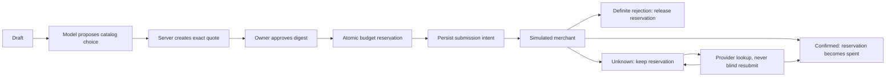

# Cosigna intelligence and transaction service

**Identity, 27 October 2026:** the first provider-neutral identity boundary now lives in Rust:
verified JWT access tokens, operator-enrolled users, organizations, memberships and scoped
identity reads. [Explicit identity-to-approver bindings](../../docs/GATEWAY_IDENTITY_APPROVALS.md)
now authorize organization-scoped money approval with transaction-time revocation, scope and
limit checks. Membership alone grants no payment authority; browser sign-in and real IdP
validation remain pending. See [the identity contract](../../docs/GATEWAY_IDENTITY.md).

**Gateway priority, 23 October 2026:** [Cosigna Gateway](../../docs/COSIGNA_GATEWAY.md)
now adds registered, budget-bound agents and a separate headless `/gateway/v1/` API.
Run `cargo run -p cosigna-agent -- gateway-demo` to exercise agent planning, owner-only
exact approval, authorized execution, replay, over-budget blocking and revocation without
voice, a model API key or real payments. Agent credentials are stored as hashes, and task
attribution is durable. This remains a local development gateway, not production identity
or trained-model deployment. The existing v1 API and mobile/test envelopes are preserved.

First development increment: a hosted reasoning adapter and a durable, independently enforced
purchase lifecycle. All merchant payments are **simulated**. The iOS/Android app and console are
not yet connected to this API. No live order, payment, location, voice or identity verification
is implemented here.

Next increment: [voice commerce lab](../../testbeds/voice-merchant/README.md). A standalone test
merchant now exposes a real HTTP catalog/order/lookup API, persistent inventory and a staff
counter. Cosigna's optional `--test-merchant-url` connector talks to it over authenticated
loopback HTTP. The lab launcher supplies its private token and an independent ledger profile.
It supports recorded voice → hosted transcription → quote → owner click → test order. It is
not a live payment or mobile integration. The original `demo` and fixture defaults still work.

The lab also supports a separate Stripe sandbox profile: the merchant uses real test
PaymentIntent creation/confirmation/retrieval behind this service's existing approval and
budget controls. The merchant order exposes the Stripe payment/charge identifiers. No real
funds move, and no Stripe credential or SDK dependency is added to the Rust engine.

## Run on Windows

From `C:\Users\Harsha\Pictures\project` with the workspace Rust toolchain:

```powershell
cargo run -p cosigna-agent -- demo
cargo run -p cosigna-agent -- init
cargo run -p cosigna-agent -- serve --planner fixtures
```

The demo uses a temporary directory and no network: two 700-cent synthetic purchases, one
lost response recovered by lookup, and a third purchase blocked by the 2,000-cent budget.
`fixtures` is a deterministic script, not an AI model. It recognizes exactly `Order one oat
latte` and `Order one black coffee`; other wording asks for clarification.

`init` creates `%LOCALAPPDATA%\Cosigna\agent-dev` by default. `init` and `serve` accept
`--data-dir <private-directory>`. Keep this directory outside the repository: it contains
private role credentials and requests. Existing credentials are preserved, not printed.
On Unix the credential file is created with mode 0600; on Windows it inherits directory
ACLs. Custom directories need appropriate local access restrictions.

By default the API listens only on `127.0.0.1:3092`. It rejects browser `Origin` headers and
unexpected `Host` headers, and has no CORS support. To self-host it behind a TLS proxy, use
`serve --listen 0.0.0.0:3092 --public-host <name>`: requests must then name that host and
arrive with `X-Forwarded-Proto: https`, or they are refused. A non-loopback address without
`--public-host` is refused at startup. `deploy/docker` runs it this way with Docker Compose
(gateway, worker and a Caddy TLS proxy); secrets can come from files (`<NAME>_FILE`).
The server handles up to `--max-concurrent` requests at once (default 32) and answers
503 `busy` beyond that; a request slower than `--request-timeout` seconds (default 120) gets 504
`timed_out`, while work it started still finishes and is recorded. On Ctrl-C or SIGTERM it stops
accepting and finishes requests in progress. Each credential has its own request budget
(`--rate-limit`, default 20 per second), an address that keeps sending wrong tokens is blocked
for the rest of the minute (`--refusals-per-minute`, default 30), and some slots are kept for
people so agents cannot crowd out approvals (see STORAGE_FORMAT.md). Production identity
remains work. A separate opt-in durable `worker`
process now schedules owner-enrolled tasks, waits for exact approval and reconciles unknown
outcomes. With `--alerts`, it also tells people in Slack or through a signed webhook when a
payment is held, needs a second approver, or has an unknown result (`examples/alerts`). See [persistent server operation](../../docs/GATEWAY_OPERATIONS.md) for local commands,
queue controls, recovery limits and private Linux systemd templates. No server is provisioned.

## Hosted planner

Decision, 22 October 2026: use hosted working model APIs first. No model weights, quantization,
GPU provisioning or local inference server are required. Quantization changes numerical
precision; it does not by itself remove active transformer layers.

Start with `gpt-6.1-sol`, low reasoning effort, through the Responses API. The optional
`gpt-6-luna` model is available for an accuracy/latency comparison. Both officially support
structured outputs. This is an implementation baseline, not an observed latency or accuracy
result. No live inference was run while implementing this increment.

Sources: [GPT-6.1 Sol](https://developers.openai.com/api/docs/models/gpt-6.1-sol),
[GPT-6 Luna](https://developers.openai.com/api/docs/models/gpt-6-luna),
[Structured outputs](https://developers.openai.com/api/docs/guides/structured-outputs).

Supply `COSIGNA_OPENAI_API_KEY` only to the backend process, using your environment/secret
manager. Do not put it in a mobile bundle, repository, task, prompt or console log. Then run:

```powershell
cargo run -p cosigna-agent -- serve --planner openai --model gpt-6.1-sol
```

Groq is an additional explicit hosted option. Set `COSIGNA_GROQ_API_KEY` on the backend and
run `cargo run -p cosigna-agent -- serve --planner groq`. Its default is
`openai/gpt-oss-120b`; `--model openai/gpt-oss-20b` is also accepted. Each provider accepts
only its own model allowlist and sends to its own fixed HTTPS endpoint; there is no automatic
fallback. Both adapters use the same strict plan schema and local validation and have no
approval/execution tools. See [Groq Responses](https://console.groq.com/docs/responses-api)
and [structured output](https://console.groq.com/docs/structured-outputs).

Planning through `/plan`, pipeline advance or the worker in hosted mode incurs provider charges.
The adapter sends the request, required features, currency, per-purchase ceiling and the
synthetic catalog to the selected provider's fixed HTTPS endpoint. It does not send role credentials,
payment credentials, user IDs or task idempotency keys. `store:false` is requested; this is
not a claim of zero provider retention. A 30-second request timeout and 256-KiB response
limit apply. Errors/refusals/incomplete output do not authorize anything. Successful
planning replays return the existing quote rather than repeating inference. A ledger-local
OS lock rejects concurrent planning before inference; optimistic versions still prevent
overwriting a changed task. Worker inference failures/interruption pause for review rather
than automatically retrying paid calls. Production/provider-wide rate limits and billing
deduplication are not implemented.

The model can return only a catalog offer ID and quantity, or a clarification. Prices,
seller, currency, terms and fulfillment are loaded from the provider catalog by code.
Budget constraints and explicitly supplied `required_features` are checked again by code;
interpreting every nuance of free text still depends on model quality and owner review.
Prompt instructions alone do not establish resistance to prompt injection.

## Try the authenticated API

In a second PowerShell terminal, load the development tokens into headers without displaying
them. These tokens represent three roles for one local development user, not three independently
authenticated people. Do not give a planner process the whole credential file.

```powershell
$base = 'http://127.0.0.1:3092'
$creds = Get-Content "$env:LOCALAPPDATA\Cosigna\agent-dev\credentials.json" -Raw | ConvertFrom-Json
$owner = @{ Authorization = "Bearer $($creds.owner)" }
$planner = @{ Authorization = "Bearer $($creds.planner)" }
$executor = @{ Authorization = "Bearer $($creds.executor)" }

function Send-Cosigna($Path, $Headers, $Payload) {
    Invoke-RestMethod -Method Post -Uri "$base$Path" -Headers $Headers `
        -ContentType 'application/json' -Body ($Payload | ConvertTo-Json -Depth 12 -Compress)
}

$budget = (Send-Cosigna '/v1/budgets' $owner @{
    currency = 'USD'; limit_minor = 2000; per_purchase_minor = 1000
    merchants = @('fixture-cafe')
    expires_at = [DateTimeOffset]::UtcNow.ToUnixTimeSeconds() + 3600
}).data
$task = (Send-Cosigna '/v1/tasks' $planner @{
    budget_id = $budget.id; request = 'Order one oat latte'
    idempotency_key = [guid]::NewGuid().ToString(); required_features = @('oat_milk')
}).data
$quote = Send-Cosigna "/v1/tasks/$($task.id)/plan" $planner @{}
$quote.data.quote | ConvertTo-Json -Depth 12
```

Review the complete quote: item, quantity, seller, all-in minor-unit total, currency,
fulfillment, terms and expiry. Approval binds its exact digest, not merely a price ceiling.
After reviewing, run the owner approval and separate executor action:

```powershell
Send-Cosigna "/v1/tasks/$($task.id)/approve" $owner @{ quote_digest = $quote.approval_digest }
Send-Cosigna "/v1/tasks/$($task.id)/execute" $executor @{}
Invoke-RestMethod "$base/v1/tasks/$($task.id)" -Headers $owner
Invoke-RestMethod "$base/v1/budgets/$($budget.id)" -Headers $owner
```

Every authenticated response includes `schema: cosigna.agent/v1` and
`simulated_provider: true`. Monetary values are integers in minor units; no floating point
conversion or implicit currency conversion occurs. Quotes expire after at most five minutes.

| Endpoint | Required role / purpose |
|---|---|
| `GET /v1/health` | Public, minimal status |
| `GET /v1/catalog` | Any authenticated role; synthetic offers |
| `POST /v1/budgets` | Owner creates a capped, expiring merchant allowance |
| `GET /v1/budgets/{id}` | Any role belonging to the owner; reserved, spent, available |
| `POST /v1/budgets/{id}/revoke` | Owner; `{}` |
| `POST /v1/tasks` | Owner/planner; owner-scoped idempotency key |
| `GET /v1/tasks/{id}` | Any role belonging to the owner |
| `GET /v1/tasks/{id}/events` | Same; event names and timestamps, no tokens/model reasoning |
| `POST /v1/tasks/{id}/plan` | Owner/planner; `{}` |
| `POST /v1/tasks/{id}/approve` | Owner; `{ "quote_digest": "..." }` |
| `POST /v1/tasks/{id}/execute` | Executor; `{}` or a fixture scenario |
| `POST /v1/tasks/{id}/reconcile` | Any role belonging to the owner; `{}` |
| `POST /v1/tasks/{id}/resolve` | Owner; `{}`; settles an unknown attempt by voiding it at the provider |
| `POST /v1/tasks/{id}/cancel` | Owner, before submission; `{}` |

Unknown JSON request fields are rejected. Fixture execution scenarios are `success`,
`decline`, `timeout_after_accept`, `timeout_before_accept`; for example
`@{ scenario = 'timeout_after_accept' }`. No endpoint can change a catalog price or supply
an arbitrary merchant URL. The local provider library exposes synthetic price changes for tests.

## Transaction boundary



The ledger uses SQLite immediate transactions to serialize approval/reservation and submission
claims across service instances. The independent fixture-provider database records one result
per stable attempt key. A task has one submission attempt. A crash or unknown result requires
lookup; execution replay never resubmits. A missing result is not considered proof of failure.
An unknown result stays held until the owner resolves it. `resolve` asks the provider to void
the attempt: if the provider accepted it, its receipt confirms the purchase; otherwise the
provider records that the attempt can never succeed (a late copy of the request is refused)
and only then is the reservation released. If the provider cannot answer, the task stays
unknown and held. The Stripe test merchant answers by retrieving the PaymentIntent or, when
its ID was never received, repeating the original create with the same idempotency key
(within Stripe's 24-hour key window) and canceling it unless it succeeded. There is no
force-release that skips the provider.

Replanning clears prior approval and releases its pending reservation. Reapproval is required.
Library versions prevent a delayed model result overwriting newer approval/state. Revocation
and expiry prevent new submission claims; revocation cannot undo a request already claimed.
Revocation leaves pending reservations held until owner cancellation (before submission) or
reconciliation (after submission). Cancellation after submission is rejected; refunds are a
separate future workflow.

## Money operations

Agents with an operations grant request refunds and payouts through
`POST /gateway/v1/operations`. The rail verifies the request against its own records first.
Policy then denies it (outside the grant, per-operation limit or budget), approves it
automatically up to the agent's `auto_approve_minor`, or holds it for the owner, who approves
the exact `proposal_digest`. Approved operations execute on the server; agents never hold rail
credentials. Unknown results stay held until the owner resolves them through the rail. Every
step, including denials, is evidence. Rails: the synthetic `fixture` rail, and `stripe_test`
(Stripe test-mode refunds) when the service starts with `--stripe-test`. The gateway holds the
Stripe key; agents never see it:

```powershell
# The key you stored earlier with `fabric secret set stripe-test` is used automatically.
cargo run -p cosigna-agent -- serve --data-dir <profile> --stripe-test
```

Every refund uses an idempotency key derived from its single attempt and is confirmed by
retrieving it from Stripe. Details are in [STORAGE_FORMAT.md](../../docs/STORAGE_FORMAT.md).

`scripts/stripe-test-check.mjs` runs the rail against a real Stripe test account, with the key
in `COSIGNA_STRIPE_TEST_SECRET_KEY` (live keys are refused). It makes two test-card payments,
then checks: a refund within the agent's limit is made once, even when the agent repeats it; a
refund above what is left is denied; one above the limit is held with nothing sent to Stripe,
then made when the owner approves; an unknown payment is denied; a live key is refused; the
evidence verifies; and the key is in no gateway file. It passed by hand on 26 October 2026. It
is not part of `cargo test`, which uses a local stand-in.

## Agent tools (MCP)

`cosigna-agent mcp --gateway-url http://127.0.0.1:<port>` serves the money operations as MCP
tools for one agent: `cosigna_request_refund`, `cosigna_request_payout`,
`cosigna_operation_status` and `cosigna_budget`. It reads only that agent's token from
`COSIGNA_AGENT_TOKEN`. It holds no owner or rail credential and no ledger access, and it refuses
unknown arguments. Replies tell the agent the outcome and what to do next (paid, waiting for a
person, denied and why). They never include approval digests. Example Claude Code config:

```json
{"mcpServers": {"cosigna": {"command": "cosigna-agent",
  "args": ["mcp", "--gateway-url", "http://127.0.0.1:3092"],
  "env": {"COSIGNA_AGENT_TOKEN": "agentkey_..."}}}}
```

## Evidence

Every budget, agent grant, task step and scheduler delegation is appended to a hash-chained
`evidence` table in the same transaction as the change: who acted (owner, role, agent), the
budget terms, the exact quote and its digest, the amount held or spent, the attempt key and
the provider outcome. Tokens and request text are not recorded (the request is bound by its
digest). Refused operations record nothing.

```powershell
cargo run -p cosigna-agent -- evidence verify --data-dir <profile>
cargo run -p cosigna-agent -- evidence export --data-dir <profile> --out evidence.jsonl
```

`verify` re-hashes the chain and checks that current budgets, tasks, reservations and agents
match their last record, so a direct database edit is reported (exit code 5). It cannot detect
a consistent rewrite of the whole chain by someone with write access; signed packs and
external anchoring are next ([#79](https://github.com/Project-Fabric/fabric/issues/79)).
Records use the engine's evidence record format; see
[STORAGE_FORMAT.md](../../docs/STORAGE_FORMAT.md). A ledger upgraded from version 3 lists its
earlier budgets, tasks and agents as unevidenced rather than reconstructing their history.

This does not claim general exactly-once payments, crash/power-loss testing, cryptographically
signed evidence, durable distributed execution, live payment authorization, or protection
against a compromised local account. The local ledger is authoritative for this experiment;
it is separate from existing Fabric/Cosigna project storage and CLI mandates. User/device
authentication, passkeys/biometric step-up, delegated grants, conversation/clarification
resumption, web/maps tools, live merchant access and mobile wiring remain to be built.

## Verify

```powershell
cargo test -p cosigna-agent
cargo fmt --all --check
cargo clippy --workspace --all-targets -- -D warnings
cargo test --workspace
```

Tests use temporary databases, synthetic merchants, a fake model transport and loopback HTTP.
They exercise budget and execution races, exact approval, ownership/roles, catalog constraints,
replay, quote drift, stale plans, expiry/revocation, timeout reconciliation across reopen,
the acceptance-to-ledger crash boundary, foreign/future storage rejection, malformed/refused
model output and the real CLI/HTTP boundary. No API key or paid service is used by the tests.
