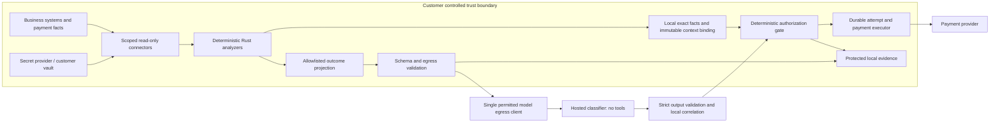

# Protected data to AI outcome boundary

Status: proposed design for review, 30 October 2026. No production implementation is claimed.
First scope: support refunds. This adds a boundary around optional Cosigna-controlled model
analysis; it does not replace the deterministic payment gate or secure an external agent's
independent access to tickets. Existing case adapters are inputs, not this whole boundary.

## Purpose and security claim

Customer-owned code reads protected business records and computes a minimal, schema-checked
outcome object. Only that object and approved task instructions may enter a hosted model.
The model returns a recommendation. Deterministic code remains the only spending authority.

Encryption protects transport and storage. The analyzer is an explicitly authorized endpoint
and sees plaintext in memory while computing. This is not computation on encrypted data,
homomorphic encryption, or proof that a compromised customer host cannot access records.
Specify exactly which components terminate TLS and hold decryption keys before describing
the deployment as end-to-end encrypted. A TLS-terminating proxy is another plaintext endpoint.

The defensible initial claim is: Cosigna's configured egress boundary sends only the validated
outcome contract for these model calls. Bucketed data reduces disclosure; it does not prove
anonymity or prevent inference from repeated outcomes and network metadata.

## Components



Keep these as modules in one service for the first version. A separate classifier process
may enforce a real network/credential boundary when needed; do not start with a collection
of independently deployed services.

## Analysis and projection

1. Authenticate the caller and resolve a trusted workflow assignment. The assignment binds
   the permitted case, payment, operation and amount constraints; the proposing agent cannot
   broaden it.
2. Read the authoritative mapped fields with a read-only connector. Fields establishing
   entitlement must not be writable by the requesting agent. HTTPS authenticity alone does
   not make a ticket's content or a mutable field authoritative.
3. Compute exact amounts, currency, cumulative entitlement, duplicates, refund-window
   eligibility and source freshness in Rust. Missing evidence remains unknown.
4. Apply deterministic hard restrictions. Skip model calls when the request is already denied.
5. Build the external object from a new allowlisted struct. Never serialize the raw source
   object and then attempt to remove private fields. Reject unknown fields and bound sizes.
6. Keep exact identifiers, amounts, source revision, policy version, request fingerprint,
   context digest, nonce and expiry in the local context binding. These do not need to be
   sent to the model. The client correlates the response with its outstanding call.

Proposed outbound contract (an example, not an implemented schema):

```json
{
  "schema": "cosigna.refund-features/v1",
  "entitlement_check": "match",
  "duplicate_check": "clear",
  "refund_window": "within",
  "source_freshness": "current",
  "value_band": "low"
}
```

Allowed values must be fixed in the reviewed schema:

- entitlement_check: match, exceeds, mismatch, unknown.
- duplicate_check: clear, committed, unresolved, unknown.
- refund_window: within, outside, unknown.
- source_freshness: current, stale, unavailable.
- value_band: low, medium, high, unknown; thresholds are customer policy, not model choices.

No arbitrary flag names, customer identifiers, rare free-text labels, filenames, raw code,
ticket content, URLs, exact amounts, payment references or secrets enter this payload.
Unknown is distinct from false. Do not add a feature unless a documented classifier task
needs it and its utility/disclosure tradeoff has been evaluated.

## Model output and spending authority

Proposed output:

```json
{
  "schema": "cosigna.refund-review/v1",
  "recommendation": "require_review",
  "reason_code": "insufficient_evidence"
}
```

Recommendation enum: defer_to_policy, require_review. Reason codes come from a fixed small
catalog. No execution tool, approval flag, amount, destination, policy mutation or free text.
Model agreement is not permission. A deterministic deny stays denied. A deterministic hold
stays held. A model can tighten an otherwise permitted request. If required analysis is
unavailable, malformed, late or correlated to stale context, hold rather than spend.

At approval/execution, reload authority and verify context freshness and exact proposal
binding. A changed source, amount, policy or expiry cannot silently reuse the earlier review.
Perform accounting checks and reservation atomically before creating execution work. Keep
external calls outside the accounting lock and preserve existing uncertain-attempt rules.

## Encryption, egress and evidence

- Use reviewed TLS libraries, authenticated workload identities where a network boundary
  exists, and a customer-owned secret-provider interface. A vault/KMS adapter is optional
  deployment infrastructure, not a model tool or a new mandatory cloud dependency.
- Encrypt stored sensitive source material if it must be retained. Prefer not retaining
  raw bodies. Specify backup, log, crash-dump and temporary-file handling too.
- Restrict model egress to approved endpoints and routes. Validation checks the constructed
  typed payload and fixed instructions before sending; a regex alone is not the boundary.
- No model browser, shell, retrieval, arbitrary URL, upload or payment tools on this path.
- Record contract/analyzer/policy/skill versions, payload digest and permitted structured
  payload, provider/model identity as available, outcome and timings in protected local
  evidence. Do not claim a log proves the absence of all other host egress.
- Synthetic canaries belong in tests. Check model requests, logs, exports and outputs for
  leaks; do not place new sensitive canary data into real customer records.
- Model-provider retention/training commitments require the actual account's applicable
  contract and feature settings. Payload minimization does not establish those commitments.

## Security guardrails required before external use

These are requirements, not claims of delivered protection. Encryption does not repair a
vulnerable endpoint or prevent a trusted administrator from misusing plaintext access.

| Attack surface | Required control | Acceptance evidence |
|---|---|---|
| Prompt injection in tickets or model outputs | Never load raw text into the outcome-only model; validate fixed output enums; no model execution tools | Encoded/multilingual instructions cannot change authority, destination or payload shape |
| Compromised agent or cross-tenant access | Derive principal/tenant from verified authentication; bind task/case/amount; scoped, expiring, revocable grants | Guessed identifiers and another tenant's context disclose no records and move no funds |
| Malformed JSON/CSV, SQL/shell/path injection | Bounded strict parsers, parameterized SQL, fixed paths; no eval, shell execution or agent-provided plugins | Oversized, nested, duplicate-key and malformed records fail safely; fuzz tests preserve invariants |
| SSRF, redirects and DNS changes | Administrator-approved connector destinations; connect only to validated addresses; network egress allowlisting; no automatic redirects | Unapproved destinations and metadata endpoints receive no requests or credentials |
| Source tampering or stale facts | Business-owned entitlement fields, source provenance/freshness and local context binding | Agent-editable claims never establish authority; changed records invalidate stale analysis |
| Replay, stale approval and races | Single-use/context-bound decisions, exact proposals, atomic reservations and durable attempt identity | Concurrent replay has one logical effect; changed payload conflicts; no overspend |
| Outcome leakage and inference | Minimal feature catalog, query authorization/quotas and disclosure review; no per-user labels in metrics | Canary bytes absent in captured requests/logs; sensitive raw-only fields do not alter outputs |
| Logs, metrics, backups and crash dumps | Data minimization, restricted access/retention and backup encryption; protected audit payloads | Secret/canary scans cover artifacts, errors, traces and restored backups |
| Malicious dependency or altered analyzer/skill | Locked dependencies, vulnerability review, SBOM, reviewed versions and verified release provenance | Altered release or skill cannot be promoted without review; rollback restores known artifact |
| Host/container compromise | Non-root, read-only code, minimal mounts/capabilities, separate identities; no Docker socket or host secrets | Deployment tests verify filesystem/network restrictions; threat model states root/admin limitations |
| Denial of service or review flooding | Body/depth/time/concurrency limits, tenant quotas and bounded pending work; reserve recovery/control capacity | Saturation cannot starve status/revocation; malformed traffic does not create unbounded holds |

No finite attack suite proves the absence of bugs. Record coverage, failures and known
limitations; require independent review before live funds. Account takeover and supply-chain
compromise need controls beyond input filtering. Model output is never trusted as code.

Implementation guidance: [OWASP prompt injection](https://cheatsheetseries.owasp.org/cheatsheets/LLM_Prompt_Injection_Prevention_Cheat_Sheet.html),
[OWASP SSRF](https://cheatsheetseries.owasp.org/cheatsheets/Server_Side_Request_Forgery_Prevention_Cheat_Sheet.html),
[NIST secure development practices](https://pages.nist.gov/nccoe-devsecops/example-implementation-1-2/appendix-c.html).

## Evaluation before enabling the classifier

Compare deterministic rules alone, rules plus the outcomes-only classifier, and an offline
reference evaluation with fuller context. Use the same independently labelled cases and
separate held-out cases. Only synthetic or explicitly permitted data may be used for raw-
context evaluation; never send private raw records out merely to benchmark the boundary.

Measure missed legitimate refunds, wrong-but-permitted requests, unnecessary holds, review
work, inference cost and latency. Identical feature objects with different correct semantic
answers reveal information the projection cannot carry: route those cases to human review,
not a more confident model. If the classifier adds no measured benefit, retain rules only.

Boundary tests must demonstrate: raw-only field changes do not affect outbound payload;
unknown fields/extra output are rejected; canaries do not leave via requests/logs; replayed
or stale responses cannot authorize another request; model timeouts never loosen decisions;
concurrent requests cannot overspend a shared budget/case; lost replies preserve reservations.

## Ordered build

1. Agree refund source authority, context binding and feature/output schemas.
2. Implement pure Rust analyzers and allowlisted projection with synthetic boundary tests.
   No model call is required to verify this stage.
3. Add the local immutable context registry, expiry, provenance and freshness checks.
4. Add one optional egress adapter with a mock transport, strict output parsing and protected
   evidence. Verify OS/container egress policy separately from application allowlisting.
5. Run the classifier in shadow mode without influencing payments. Promote only after
   measured benefit; first promotion can add holds only and supports immediate disable.
6. Add customer-specific vault/identity integrations and external checkpointing as separate
   reviewed deployment work. Payouts, purchases and arbitrary code analysis remain later.

Planning estimate: 60–100 engineering hours for a narrow tested prototype, approximately
6–10 weeks at 10–12 hours/week, excluding recovery repairs, enterprise identity, third-party
security review, deployment-specific encryption/key management and customer validation.

## Open decisions

- Which business-owned structured field establishes entitlement and who can edit it?
- Who issues workflow assignments, and can an external support agent bypass this boundary?
- What useful decision is left for a model after these deterministic checks?
- Which source revisions and freshness windows are enforceable in the first connector?
- Is local semantic extraction allowed at all? Default first version: no; ambiguous text
  goes to a human rather than becoming an invented entitlement.
- Which actors are trusted to administer hosts, deploy analyzer code and access keys?
- Which outcome combinations are sensitive to a customer despite containing no direct IDs?
