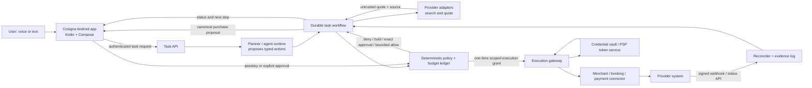

# Cosigna Android agent architecture research

> **Scope correction, 22 October 2026:** the product targets **iOS and Android**. This document's Android-specific guidance is one platform implementation of the shared workflow. The current recommendation is to retain the existing cross-platform prototype for the first real-booking experiment; using Android Studio does not require rewriting it in Kotlin. See [COSIGNA_VOICE_AGENT_STACK.md](COSIGNA_VOICE_AGENT_STACK.md) for the current voice/model architecture, iOS integration, available weights, hardware constraints and real-world test plan. The native Kotlin recommendation below is historical, not an approved migration decision.

**Researched:** 22 October 2026

**Purpose:** define how the Android app, agent runtime, spending authority, merchant integrations and payment flow should fit together before replacing the Expo prototype with a native Android Studio project.

## Recommendation

Build Cosigna as a native Kotlin and Jetpack Compose app backed by a task service and a deterministic authorization/execution layer. The model should plan and explain; it should never receive merchant credentials, decide whether policy permits spending, or directly submit a payment. Each external action must pass a typed connector and a separate policy check immediately before execution.

Design for many domains, but do not assume every installed app or website can be operated. Start with providers that expose supported commerce APIs or partner integrations. If a provider only supports its own checkout, Cosigna should prepare the task and hand the user to the official app or site. Universal checkout is not a capability Android grants to an ordinary app.

## What Android can integrate with

Use these integration paths in order:

1. **Provider API or partner checkout.** The merchant/provider gives Cosigna an authorized API, OAuth connection or documented checkout protocol. This is the reliable path for quotes, order IDs, asynchronous status and cancellations. Build a capability matrix per provider, country and account type; a public API's existence does not prove Cosigna has access or that it supports consumer checkout.
2. **Open commerce protocol, where the provider actually supports it.** Evaluate ACP and similar protocols as adapter contracts, not as universal access. ACP describes structured checkout while the merchant keeps its existing backend/payment processing. Validate production availability, seller coverage, terms and supported payment methods before promising execution.
3. **OAuth data access or explicit Android handoff.** Use scoped, revocable account access for supported read operations. When a user must finish checkout, open the official provider app/site or a verified Cosigna App Link with a clearly explained handoff. Return to Cosigna through a verified link and reconcile from provider evidence.
4. **Browser automation only as a reviewed exception.** Restrict it to named providers whose terms and technical controls allow it; isolate the browser and credentials, preserve the same policy checks, and stop for login, CAPTCHA, 3-D Secure or unexpected screens. Never claim it works with arbitrary apps.

Do not use an Accessibility Service as a general-purpose way to click through other apps. Android describes accessibility services as specialized assistive tools and cautions against treating them as a standard interaction mechanism. Android AppFunctions may eventually expose discrete app actions to trusted system agents, but the API is still experimental, is for Android 16+, and access to the full agent pipeline is limited. It is a future-compatible adapter opportunity, not a foundation for Cosigna's first release. [Android accessibility service guidance](https://developer.android.com/guide/topics/ui/accessibility/service), [Android AppFunctions status](https://developer.android.com/ai/appfunctions), [verified App Links](https://developer.android.com/training/app-links/about)

## System shape

The model proposes only schema-validated actions such as `SearchFlights`, `GetOffer`, `CreateCart`, `RequestApproval` or `SubmitOrder`. The workflow service owns task state; the policy service independently decides whether a proposal is allowed; only the execution gateway can call write-capable provider endpoints.

### Android client

- Use a single-activity Compose app with screen-level ViewModels, repositories and unidirectional state flow. Keep navigation, UI state and provider data sources separate. This follows Android's current architecture recommendations. [Android architecture recommendations](https://developer.android.com/topic/architecture/recommendations)
- Use Android Credential Manager for Cosigna sign-in/passkeys. Use system browser authorization with OAuth Authorization Code + PKCE for provider connections; avoid embedded login WebViews. Store only app/session material that must be on-device, protected with Android Keystore-backed keys. [Credential Manager](https://developer.android.com/identity/credential-manager), [Android Keystore](https://developer.android.com/privacy-and-security/keystore), [OAuth 2.0 Security BCP (RFC 9700)](https://datatracker.ietf.org/doc/html/rfc9700)
- Keep a local read cache for task status, approvals and preferences. Offline, allow drafting and reading; do not queue an unreviewed purchase for later execution. The server must re-check current policy and quote freshness when connectivity returns. Android recommends a local source of truth for offline reads. [Offline-first Android data](https://developer.android.com/topic/architecture/data-layer/offline-first)
- Ask for location only when the user starts a route/location task. Support manual address entry and approximate location when adequate; avoid always-on/background tracking in the first version. [Android location permission guidance](https://developer.android.com/develop/sensors-and-location/location/permissions)
- A biometric dialog can unlock a local operation or signing key, but the service must verify a transaction-bound passkey/assertion or equivalent proof. A local “biometric succeeded” Boolean is not server-verifiable identity. Do not use voiceprint recognition as payment authorization.

### Backend and authority boundary

- **Task API:** authenticates a user/device session, accepts an idempotent request, and returns a task ID. It enforces ownership on every read/write and separates account identity from a user-supplied agent name.
- **Planner:** turns the request into typed steps and asks clarifying questions. Provider pages, search results, catalog text, user-generated content and tool outputs are untrusted inputs: they can inform a proposal but cannot change authority, tools, recipients or limits.
- **Workflow coordinator:** persists progress and resumes it after process/server restarts. Keep domain-specific task details (flight traveler/date/fare rules versus shopping seller/variant/shipping) while sharing quote, approval, reservation and evidence primitives.
- **Policy and budget ledger:** deterministic code evaluates the authenticated user, active grant, exact seller/provider, operation, merchant/account, item, total, currency, delivery/fulfillment, time, recurrence and risk conditions. It atomically reserves the maximum permitted amount across concurrent tasks. A policy service outage means no write action.
- **Execution gateway:** accepts a short-lived, one-time capability bound to the task, connector, operation, quote hash, amount/currency, user/grant, expiry and idempotency key. It rejects any payload that differs from the approved proposal. The agent runtime cannot call the provider directly.
- **Provider credentials:** OAuth scopes and refresh tokens live server-side in an encrypted, access-controlled vault where the supported provider model requires that. The agent never sees them. Use narrowly scoped, revocable credentials and rotate/revoke on disconnect. For mobile-only provider flows, use provider-supported authorization and token exchange patterns; never store a merchant password.
- **Payment instruments:** use a licensed payment provider's hosted UI/SDK or scoped token primitive. Keep PAN/CVV out of the model, app database, logs and Cosigna services. Tokenization may reduce exposure but does not automatically remove PCI responsibilities; scope depends on the complete system and provider/acquirer assessment. [PCI SSC tokenization FAQ](https://www.pcisecuritystandards.org/faqs/1580/), [PCI DSS](https://www.pcisecuritystandards.org/standards/pci-dss/)
- **Evidence/reconciliation:** store append-only task events, policy inputs/decision, quote provenance, approval proof, connector request reference, provider IDs, webhook verification outcome and observed status. Keep secrets and unnecessary identity documents out of logs. Webhook events are verified, deduplicated and reconciled against provider state before telling the user an order is complete.

## Purchase lifecycle

1. **Capture intent.** Convert speech/text into a goal and structured constraints. Confirm material ambiguities such as traveler, date, item variant, delivery address, pickup location, currency or maximum spend. Transcription or “yes” from an ambient voice assistant is not payment consent.
2. **Research and quote.** Use read-only tools first. Return source, provider, seller/location, exact item/offer, all-in total, currency, fulfillment, estimate and expiry. Label estimates separately from provider-confirmed facts.
3. **Check grant and reserve.** Evaluate all constraints and aggregate period limits atomically. If any condition is missing, outside policy or not machine-verifiable, hold for the user or deny. A budget is an authorization ceiling, not a Cosigna wallet balance.
4. **Show the purchase card.** Present merchant, item/flight, quantity/variant, delivery or pickup, fees/tax/tip, total and currency, payment method nickname, relevant cancellation/fare terms, why it is allowed/held, and the grant/budget impact. The person should understand the action without reading a chat transcript.
5. **Bind approval.** An approval signs/authorizes a canonical snapshot (hash) of the exact proposal and its expiry. Any change to seller, item, quantity, dates, fulfillment, price, currency or terms invalidates that approval and requires a refreshed quote. Step-up with passkey/system authentication for a new payee, a high amount, changed details or a new device. Small repeat purchases may later run without per-purchase prompts only under a deliberately configured, narrow, revocable grant.
6. **Execute once.** Revalidate quote, grant, reservation and provider account immediately before the write. Send a stable idempotency key. Do not blindly retry a timeout; first query/reconcile whether the provider accepted the request.
7. **Reconcile and explain.** Keep payment and fulfillment as separate states: authorization/payment accepted does not mean the merchant accepted the order or prepared it. Handle partial acceptance, price changes, `requires_action`, pending, declined, cancellation and unknown outcomes. An unknown outcome remains unresolved until provider status is checked; it never triggers a second purchase automatically.
8. **Close the loop.** Show confirmed order/booking IDs and source, receipt/status, how to cancel/change, and whether a budget reservation is still held. Release reservations only on evidence of cancellation/expiry; refund events do not silently restore purchase authority.

Payment authorization and capture are provider- and method-specific. For example, Stripe PaymentIntents can require additional customer action and can use manual capture only when supported; that flow is not a universal “hold the user's budget” primitive. [PaymentIntent confirmation states](https://docs.stripe.com/api/payment_intents/confirm), [capture behavior](https://docs.stripe.com/api/payment_intents/capture), [Stripe idempotency](https://docs.stripe.com/api/idempotent_requests)

## User-controlled budget model

Represent authority as explicit grants, not model memory:

- **Scope:** named providers/merchants or categories; allowed actions; products or trip constraints; permitted payment method; location/account.
- **Limits:** per-action ceiling, daily/weekly/monthly cap, count/frequency, currency, expiry and time zone. Add a hard cap for FX conversion if cross-currency use is enabled; display the rate/source/time. Do not silently convert currencies.
- **Substitutions:** default none. If the merchant changes an item, seller or total, return to review unless the grant explicitly permits the exact class of substitution and price ceiling.
- **Reservations:** count in-flight quoted/approved/executing purchases against available authority so two simultaneous agents cannot spend the same remaining budget.
- **Revocation:** pause/revoke a grant immediately, cancel queued work and prevent new provider writes. State whether already submitted or provider-pending actions can still complete.

Start with research-only and exact approval. Add bounded unattended execution only for a proven workflow with clear constraints, provider support, reliable status/cancel semantics and measurable low error rates. Never infer a spend limit from past behavior or a voiceprint.

## UX that reduces effort without hiding risk

- Put one task timeline at the center: “Finding options → quote ready → needs your approval → placing order → provider confirmed.” Do not display “booked,” “paid” or “ready” until provider evidence supports that state.
- Ask one concise clarification at a time and preserve the user's goal while they answer. Let the user correct the parsed request before the agent searches.
- Use a compact exact review card with editable fields and a single clear action, plus “change,” “cancel” and “why am I seeing this?” options. Do not pre-check tips, substitutes or expanded authority.
- Show data use in context: “Use your location once to find options along this route” with manual entry fallback. Provide a Connections screen showing account, scopes, last sync, disconnect and delete controls.
- Recover gracefully: explain that a provider does not support direct checkout and offer secure handoff; explain when a quote expired; show pending status without asking the user to pay again; let them retry only after checking order status.
- Give every agent an understandable name, owner, tool list, active grant and recent actions. “Cosigna AI” is not a sufficient identity or authorization principal.
- Design for screen readers, large text, low network and interruption. Keep critical information visible in text even when using voice.

## Threats and controls to design in from day one

| Threat | Required control |
|---|---|
| Prompt injection in merchant pages, emails or search snippets | Treat retrieved content as data, never authority; typed tool schemas; connector allowlists; no secrets in model context. |
| Stolen/unlocked phone or malicious app | Passkey/device re-authentication for sensitive actions; Keystore-bound keys; short sessions; server-side revocation; explicit exported-component/deep-link validation. |
| Stolen OAuth refresh token | Server-side encrypted vault, minimum scopes, access auditing, revocation, rotation, no token in logs or mobile backups. OAuth native flow uses system browser and PKCE. |
| Duplicate spend or request replay | Durable idempotency key, atomic budget reservation, one-use grant, replay protection and reconciliation before retry. |
| Price/seller/terms changed after approval | Hash-bound quote and approval; quote expiry; re-check before execution; changed proposal requires new approval. |
| Fake completion/webhook | Verify provider signature and event ID, deduplicate, query canonical provider status, distinguish payment from fulfillment. |
| Agent or connector compromise | Separate planner, policy and executor identities; minimal service permissions; short-lived action capabilities; per-provider egress allowlist; fail-closed policy. |
| Sensitive data leaks in telemetry, crash report, notification or backup | Data minimization, redaction, private notification previews, no PAN/credentials/identity docs in prompts/logs/backups, retention/deletion policy. |
| Overbroad location/voice access | Request foreground/location only for relevant task; no continuous recording; editable retention; clear permission rationale and fallback. |

Use [OWASP MASVS](https://mas.owasp.org/MASVS/) as the Android client security verification baseline and assess the service separately; MASVS itself covers the mobile client, not the remote endpoint.

## Build sequence for an Android Studio implementation

1. **Freeze contracts before app scaffolding:** `Task`, domain-specific `Quote`, `BudgetGrant`, `Reservation`, `ApprovalSnapshot`, `ExecutionCapability`, `ProviderResult`, and state transitions. Specify what is authoritative, who signs it, expiry and retry behavior.
2. **Threat model + abuse cases:** stolen phone, malicious prompt/page, provider outage, concurrent purchases, stale offer, duplicate webhook, currency mismatch, identity data over-collection and user denial/revocation.
3. **Fixtures-only core workflow:** shopping and travel examples with simulated providers; test quote drift, two agents competing for one budget, replay, timeout/unknown status, partial order, cancellation, revoked grant and approval invalidation. No live payment keys.
4. **Native Android shell:** Kotlin/Compose screens for request, plan, exact approval, task timeline, connections and budget controls. Use repositories/ViewModels; no provider write path from UI code.
5. **Provider selection gate:** choose the first live provider only after validating market, partner access, sandbox, OAuth scopes, purchase and post-purchase APIs, fee/tax/fare semantics, refund/cancel path and permitted automated use. Existing candidate research lists Amazon Business Ordering API and Duffel, but those do not establish arbitrary consumer Amazon access or launch readiness.
6. **One sandbox end-to-end:** connect test account, quote, approve, submit once, reconcile asynchronous status, cancel/refund where supported, export evidence. Inject failures and prove that an unknown request cannot double-buy.
7. **Security and usability review:** OWASP MASVS check, server endpoint assessment, threat review, accessibility test, adversarial prompt tests, race/replay tests and a small supervised user trial before unattended purchasing.

## Decisions still required before live purchases

- Initial country/currency and legal entity/payment-provider model.
- First provider with written API/partner access and post-purchase support.
- Whether payments are initiated directly with each seller's provider, through scoped delegated tokens, or handed off to seller checkout.
- Where the planner runs and which user data may leave the device; model/provider and retention policy.
- Whether the Rust/Fabric authorization core is embedded on Android, called by a service, or both. If embedded, define parity and server enforcement; the app must not become the only authority boundary.
- Exact policy for passkey step-up, recurring grants, delegation limits and household/shared budgets.
- Identity tasks to support; no universal identity score or voice-biometric approval is recommended.

These are architecture and product decisions, not verified compliance conclusions. Payment, privacy, consumer-protection and identity obligations depend on the launch market, the entities involved and the payment model; obtain market-specific legal/compliance review before production payments.

## Sources

- Existing Cosigna product plan: [AGENTAUTH_PRODUCT.md](AGENTAUTH_PRODUCT.md)
- Existing personal assistant/commerce research: [COSIGNA_VOICE_COMMERCE_RESEARCH.md](COSIGNA_VOICE_COMMERCE_RESEARCH.md)
- Android: [architecture](https://developer.android.com/topic/architecture/recommendations), [Credential Manager](https://developer.android.com/identity/credential-manager), [Keystore](https://developer.android.com/privacy-and-security/keystore), [AppFunctions](https://developer.android.com/ai/appfunctions), [App Links](https://developer.android.com/training/app-links/about), [location permissions](https://developer.android.com/develop/sensors-and-location/location/permissions)
- Security/payment: [OAuth 2.0 Security BCP](https://datatracker.ietf.org/doc/html/rfc9700), [OWASP MASVS](https://mas.owasp.org/MASVS/), [PCI SSC](https://www.pcisecuritystandards.org/standards/pci-dss/), [Stripe idempotency](https://docs.stripe.com/api/idempotent_requests), [Stripe PaymentIntent confirmation](https://docs.stripe.com/api/payment_intents/confirm)
- Commerce protocols: [Agentic Commerce Protocol](https://www.agenticcommerce.dev/docs), [Stripe agentic commerce overview](https://stripe.com/guides/agentic-commerce-primer)
