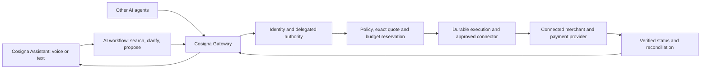

# Cosigna: gateway and assistant

**Unification update, 23 October 2026:** Cosigna is one product with gateway, console and
assistant interfaces. Harsha selected a staged code merge for the existing Fabric/AgentAuth
implementations. The landing-page refresh is authorized; the financial/runtime boundaries
below remain intact. See [the consolidation plan](COSIGNA_UNIFICATION.md).

Product direction confirmed with Harsha on 23 October 2026. This brief sets the current
delivery order: transaction gateway first, voice pickup assistant second. It supersedes
earlier interface-first priorities. Existing prototypes and ledgers are preserved.
This is a design and acceptance brief, not a new implemented API or security certification.

## One product, a shared foundation

| | Cosigna Gateway | Cosigna Assistant |
| --- | --- | --- |
| Customer | Developers and businesses operating AI agents | People ordering ahead from connected merchants |
| Job | Authorize, execute and reconcile agent-initiated transactions | Understand a spoken request and arrange a reliable pickup |
| Interface | Typed API, later SDK/MCP adapters, operational dashboard | Android/iOS voice conversation, purchase review and order status |
| Authority | Authenticated identity, explicit grants, deterministic policy and ledger | Uses gateway authority belonging to the authenticated customer |
| Evidence of success | Unauthorized writes refused; approved writes traceable; uncertainty recovered | Correct order accepted, paid and ready for pickup with less waiting |

AI agents can run the transaction workflow end to end within authority that a user or
business deliberately grants. The model does not create its own authority, expand limits,
choose arbitrary credential destinations or declare a payment successful. Code verifies
those conditions at the write boundary. Manual approval is required outside any supported,
explicit delegation; the first purchase pilot retains exact-quote approval for every order.

The gateway must operate without voice, a mobile application or a particular model provider.
The assistant is its first application. An independent agent should be able to use the same
gateway without adopting the assistant. These are module/interface boundaries; start with one
modular backend rather than creating distributed services before they are needed.

## Shared transaction path

The diagram shows logical responsibilities. External merchant content, transcripts, model
output and incoming assistant intents are untrusted inputs. An incoming task is never an
approval. Credential access and write-capable connectors belong only to the execution boundary.

## Gateway requirements

1. **Identity and scope.** Authenticate the customer/business, the requesting agent and the
   execution service separately. Derive ownership from verified identity, never a request
   field. Enforce ownership on all reads, approvals, writes and status requests. Credentials
   for a local single-owner experiment do not establish production tenant isolation.
2. **Explicit authority.** Bind a grant to owner, agent, permitted operation, merchant/payee,
   account, currency, per-purchase and aggregate limits, expiry and revocation. A grant is a
   spending authorization, not a funded wallet. Narrow autonomous grants are a later gate;
   natural-language preferences and model memory cannot grant spending rights.
3. **Exact proposal.** Obtain merchant-sourced item, quantity, location, fulfillment, total
   including fees/tax/tip, currency, terms, payment-method reference and expiry. Bind approval
   to the exact proposal. A material change requires renewed authorization. Missing facts
   produce clarification or a hold rather than an invented quote.
4. **Atomic accounting.** Reserve spending authority in the same transaction that records
   approval. Concurrent tasks cannot consume the same remaining allowance. Execution checks
   current grant, expiry, quote and reservation again. Revocation prevents future execution
   claims; it cannot undo an external operation already submitted.
5. **Restricted execution.** Use server-held, revocable execution authority bound to the task,
   connector, operation, exact proposal, merchant/account, amount/currency, payment-method
   reference and expiry. Consume the authority and record a stable attempt before external
   writes. Agents do not receive payment keys or arbitrary HTTP write tools. Cross-service
   signing/canonicalization is a separate reviewed contract, not implied by today's quote hash.
6. **Recovery before retry.** Persist attempts before submission. Use supported provider
   idempotency and authoritative lookup. A timeout is unknown until reconciled; an absent
   result is not necessarily a failed purchase. Never create a replacement payment merely
   because a phone, model or network retried. Do not claim universal exactly-once execution.
7. **Separate outcomes.** Track payment, merchant acceptance and fulfillment independently.
   Payment success with an unaccepted order needs recovery or a verified compensation path.
   Model text or a client redirect cannot establish payment success or pickup readiness.
8. **Credentials and authentication.** Keep payment/provider secrets outside agents and clients.
   Use provider-supported tokenization and customer authentication. Additional processor
   authentication can interrupt automation. Voice confirmation is an instruction, not identity.
   Passkey/device proof must be verified by the service before it supplies payment authority.
9. **Operational controls.** Provide traceable decisions, redacted evidence, authenticated
   status/revocation, bounded requests, rate limits, safe errors and recovery tooling. Verify
   webhook signatures and deduplicate events; reconcile state rather than trusting event order.
   Independent security review and measured failure tests precede a live-money pilot.

The first connector remains the existing test merchant plus Stripe sandbox. A live connector
requires actual merchant access and supported customer payment setup. Cosigna is building
an authorization/execution layer over payment providers; no new settlement network, custody
wallet, universal merchant access or protocol interoperability is claimed.

## What exists and what is missing

| Capability | Evidence in this repository | Remaining boundary |
| --- | --- | --- |
| Budget, exact approval, ownership/roles, atomic reservation | `crates/cosigna-agent/src/service.rs`; `tests/transactions.rs` | Production user identity, richer scoped grants and independent deployment controls |
| Registered agents with budget binding, plan/execute permissions, expiry and revocation | `src/agents.rs`, `src/gateway.rs`, `tests/gateway.rs` in `crates/cosigna-agent`; [gateway build guide](COSIGNA_GATEWAY.md) | Signed transaction permits, production authentication, credential lifecycle/rotation and deployment isolation |
| Retry/replay and unknown-result recovery | Same transaction tests, including concurrency and reopen/acceptance-to-ledger cases | Real process-kill tests, provider-specific recovery, durable worker operations |
| Authenticated transaction API | `crates/cosigna-agent/src/api.rs`; `tests/http.rs` | Loopback development server only; production transport, identity, concurrency and rate limits |
| Restricted AI planning | `crates/cosigna-agent/src/planner.rs`; `tests/planner.rs` | Measured task accuracy and adversarial evaluations; planning does not confer authority |
| Merchant API and payment adapter | `testbeds/voice-merchant`; Stripe test integration tests | External merchant, customer payment setup, live-money behavior and fulfillment capacity |
| Enterprise tools/mandates/evidence | Existing `crates/fabric-cli` gateway and finance controls | Separate system from the consumer ledger; integration must be explicit and versioned |
| Voice and installed Android prototype | `mobile`; hosted transcription/planning through the local lab | Product paused for gateway work; desktop backend/USB dependency and emulator audio are development limitations |

Keep the tested primitives. Redesign their contracts and deployment boundary in reviewable
increments. Do not merge existing ledgers, rename storage formats or rewrite the offline
recovery engine as part of this reset. API/storage changes require versioned contracts and
documented migration; current `cosigna.agent/v1` and mobile/test schemas remain unchanged.

## Delivery gates

| Order | Deliverable | Acceptance gate |
| --- | --- | --- |
| 1 | Gateway baseline independent of voice | Reproducible fixture purchase and safety/recovery suite, no model account required; document tested limits |
| 2 | Hardened gateway identity and execution boundary | Authenticated users/agents; cross-owner and role escalation denied; scoped grants/approval; no agent credential access; verified recovery after crash/replay/revocation |
| 3 | Payment and merchant connector pilot | One connected merchant and supported payment method; sandbox status/authentication/failure/duplicate-webhook/compensation tests; authoritative order and payment IDs |
| 4 | Merchant pickup operations | Stock and capacity-aware acceptance, scheduled pickup, staff readiness/collection updates, delay/cancellation handling |
| 5 | Voice assistant over that gateway | Voice/text parity; clarify, quote, explicit confirmation, status; silence/interruption cannot transact; foreground permission and authentication fallbacks |
| 6 | Capped live pilot | Merchant and processor access confirmed; jurisdiction/payment method chosen; security review; measured payments and actual pickup outcomes |

For gateway work, acceptance cases include wrong owner/role, altered merchant/price/currency,
expired quote, revoked grant, simultaneous spending, replayed approval/attempt, timeout before
or after acceptance, service restart, spoofed/duplicate/out-of-order webhooks, authentication
required and payment success followed by merchant rejection. Each case must identify the
connector and the evidence establishing its outcome. Passing fixture tests is not proof of
processor behavior or deployment security.

## Assistant and the queue problem

The first customer journey is: request an item, choose a connected location, obtain a real
quote and pickup window, authorize checkout, receive merchant acceptance, and collect when
the merchant reports ready. Voice and text use the same transaction workflow.

Preordering can remove the ordering/payment queue. Preparation capacity and pickup congestion
still exist. The merchant must accept a feasible pickup time and publish actual readiness;
payments alone cannot make a coffee ready before arrival. Validate this at one consenting
cafe before adding route discovery, many marketplaces, flights or general assistant tasks.

Measure arrival-to-collection time, promised-versus-actual readiness, correct-order rate,
merchant acceptance, payment/order reconciliation, duplicate charges/orders, unresolved
outcomes, manual interventions and repeat use. Compare against the merchant's existing flow.
Set numeric targets with the pilot merchant after measuring its baseline; do not invent a
zero-wait claim.

Live-pilot decisions still open: merchant/city/country, processor and payment method, user
authentication, permitted spend and refund/cancellation operations. These do not block offline
gateway validation; they do block claiming a working live commerce product.

## References checked for the redesign

- [Stripe PaymentIntents](https://docs.stripe.com/api/payment_intents) and
  [idempotency](https://docs.stripe.com/api/idempotent_requests): processor state and replay
  semantics, not a guarantee spanning merchant fulfillment and Cosigna's ledger.
- [Stripe webhook verification](https://docs.stripe.com/webhooks/signatures): authenticate
  provider events before interpreting their contents.
- [Square order fulfillments](https://developer.squareup.com/docs/orders-api/fulfillments):
  merchant pickup state is separate from payment; any connector requires actual seller access.
- [AP2 specification](https://ap2-protocol.org/ap2/specification/) and
  [flows](https://ap2-protocol.org/ap2/flows/): evaluate external mandate interoperability
  against a pinned version later. This brief does not claim AP2 implementation or conformance.
