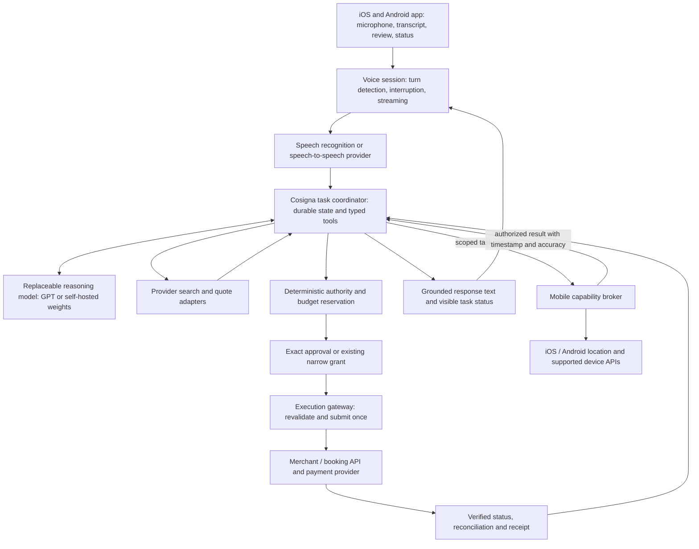

# Cosigna: iOS, Android, voice and the booking agent

Researched 22 October 2026. This updates the Android-only framing in [ANDROID_AGENT_ARCHITECTURE_RESEARCH.md](ANDROID_AGENT_ARCHITECTURE_RESEARCH.md). Scope is both mobile platforms and a working, initially supervised real-world purchase/booking experiment. This is a sourced design and evaluation proposal; it does not claim a deployed voice service, downloaded weights, provider access or a successful live purchase.

## Product architecture and mobile scope

**Stripe sandbox update:** the voice merchant lab now supports actual Stripe test PaymentIntent
creation/confirmation/retrieval after exact approval and budget reservation. A real $7.00
sandbox check verified successful payment, replay reuse and over-budget blocking before Stripe;
see `reports/stripe-protocol-*.json`. The planner in this check was the fixture script and its
owner approval came from the test driver. This is processor integration evidence, not a live
merchant, live funds, microphone-quality or real-user identity result.

**Voice/merchant testbed update:** the [voice commerce lab](../testbeds/voice-merchant/README.md)
now adds browser push-to-talk, a hosted recorded-file transcription adapter, exact-quote approval,
and a separate HTTP test merchant with persistent stock/orders and staff pickup states. Automated
tests use fake transcription and simulated payments. An actual microphone/hosted model session,
mobile connection and live external merchant purchase remain separate validations. See the
[merchant pilot research](MERCHANT_API_PILOT.md) for Square/Shopify capabilities and access limits.

**Implementation update (22 October 2026):** the first separate Rust
[intelligence/transaction service](../crates/cosigna-agent/README.md) now provides a hosted
Responses planner adapter, typed catalog selection/clarification, exact quote approval,
atomic reservations, durable submission intent and lookup reconciliation against a synthetic
merchant. The current decision is **hosted model APIs first**, replacing self-hosted weights
as the initial deployment plan. No live inference, live merchant, voice service or mobile
backend connection has been verified. Model choices below remain research candidates unless
the implementation README explicitly marks them supported.

Cosigna should accept a spoken request, clarify its constraints, find supported offers, prepare a valid quote, check spending authority, execute an authorized order and track the actual outcome. Voice, reasoning, policy and provider execution have different responsibilities and should have replaceable interfaces.

Keep the current React Native/Expo app for the first integration test on iOS and Android. Add native capabilities through development builds when necessary; Expo Go is a preview environment with a fixed set of native libraries. Android Studio can work with the generated Android native project. Local iOS native builds and device debugging use Xcode on macOS; an appropriately configured macOS build service is another build option. Do not start two UI rewrites to test whether the agent can buy something. A later Kotlin/Compose or SwiftUI decision can be made independently of the shared task API.

Sources: [Expo development builds](https://docs.expo.dev/develop/development-builds/introduction/), [Expo native project generation](https://docs.expo.dev/workflow/continuous-native-generation/), [Apple Xcode requirements](https://developer.apple.com/xcode/system-requirements/).



The existing Rust policy/evidence core remains independent of model providers and networking. Voice orchestration, model adapters and merchant connectors belong to the optional application/service layer. Do not introduce a mandatory cloud or model dependency into the offline core. Reusing existing policy primitives still requires testing consumer quote, reservation and approval semantics; the earlier Stripe refunds experiment is not proof that consumer purchasing is implemented.

## Hosted models and permissioned device tools

**Updated user direction:** use fast, functional hosted model APIs first, and let the mobile
app supply supported phone capabilities such as location and connectivity. The backend
keeps model credentials and spending checks separate from the app. Self-hosted weights remain
a later evaluation option; no GPU instance, paid service or public inference endpoint has been
created. Quantization changes numeric precision and does not inherently reduce active layers.
Evaluate model accuracy, clarification quality, failure rate, latency and cost on the actual
booking tasks before choosing a cheaper or faster default.

Use the phone's existing location stack. iOS Core Location and Android's location APIs already access the device's location sources; Cosigna implements a permissioned adapter, not a GPS system. Prefer one fresh foreground fix for an active task, accept approximate location where adequate, and offer manual location input when unavailable. Android documents that last-known coordinates can be stale and provides a current-location request. [Apple location authorization](https://developer.apple.com/documentation/CoreLocation/requesting-authorization-to-use-location-services), [Android current versus last-known location](https://developer.android.com/develop/sensors-and-location/location/retrieve-current), [Android location permission scope](https://developer.android.com/develop/sensors-and-location/location/permissions)

Expose a small set of typed capabilities rather than raw phone control:

| Tool | Where it runs | Scope/result |
|---|---|---|
| `get_current_location` | Mobile capability broker calling the OS | One task-scoped fix: coordinates, measurement time, accuracy radius, approximate/precise status and source. Return denied/unavailable/stale explicitly. |
| `capture_voice_turn` | Mobile audio session | Audio only during the visibly active user session; hosted recognition receives the necessary stream. |
| `web_search` | Backend search tool/provider | Current linked results for a query. The app's internet connection transports requests; it does not itself provide a search index or browser automation interface. |
| `find_places_on_route` | Backend maps/places adapter | Candidate places using a permitted origin and a user-supplied/saved destination. Location alone does not supply route geometry, menus, stock or booking APIs. |
| `open_provider_checkout` | Mobile browser/app handoff | Opens a validated official destination for a user-visible login, authentication or checkout step. A returned app link does not prove payment or fulfillment. |
| `read_shared_url` | Explicit user share followed by a controlled reader | Only the supplied URL/content, treated as untrusted data. No general browser history, cookies, passwords or device files are implied. |

Google documents route-aware place search as a combination of route geometry and Places Text Search, so those remain integrations even when coordinates come from the device. [Search along a route](https://developers.google.com/maps/documentation/places/web-service/search-along-route)

Internet connectivity, web search and a user's browser session are separate capabilities. The app can make network requests over available Wi-Fi/cellular; the hosted model/service uses its own network for server-side searches. Routing searches through the phone is an optional engineering choice, not a prerequisite or a way to inherit browser privileges. Android internet access is a normal manifest permission, unlike runtime location/microphone permission. Apple documents that SFSafariViewController browsing interactions, AutoFill data, history and website data are not visible to the embedding app. Android Custom Tabs can use the browser's session for a visible handoff; sharing that browser experience does not give the model ownership of the session. [Android networking](https://developer.android.com/develop/connectivity/network-ops/connecting), [Apple browser boundary](https://developer.apple.com/documentation/safariservices/sfsafariviewcontroller), [Android Custom Tabs](https://developer.chrome.com/docs/android/custom-tabs)

The hosted planner requests a capability through the task service. The service binds it to the authenticated user/device, task, permitted operation, request ID and expiry. The app checks the task's active permission and OS authorization before executing, then returns a correlated result. Reject expired/replayed/unknown operations; never accept arbitrary model-generated scripts or commands. Credentials for private model servers, merchant accounts and search providers stay outside model prompts and mobile binaries.

Separate **OS permission**, **task permission to use/share that data**, and **authority to spend**. The first permits the app to read a sensor; the second explains which task/service receives the result; the third controls a purchase. A clear contextual consent such as “Use your current location to find pickup options for this request” can cover repeated allowed reads within its stated scope without another custom dialog for every tool call. Revoking access stops further reads; retention and deletion of already transmitted data follow the disclosed policy. Raw coordinates should go only to components that need them; the planner can often work with place IDs and computed detours.

Check location age and accuracy before selecting a pickup location, and request a refresh when needed. A signed mobile response establishes the responding device/session, not that GPS coordinates are physically authentic; location is task context, not identity or payment approval.

Device tools are available only while platform execution rules and connectivity permit. If the app is suspended, offline or permission is revoked, return an unavailable state and offer reopening/manual input rather than assuming remote sensor access. The backend may keep reconciling an already submitted order without a live phone connection. Continuous location tracking or background microphone capture is a separate feature requiring platform-specific justification, permissions and device testing.

Worked example: the user asks for coffee on the way to the office; the app supplies one permitted current fix and the confirmed destination; route/merchant adapters find orderable options; the agent prepares an all-in quote; Cosigna checks the budget and approval/grant; the provider receives the order; the phone displays and speaks the provider-confirmed status. The OS supplies location and audio, hosted services supply inference/search, and the execution gateway controls spending.

## What the named voice models actually provide

| Candidate | Capability and weight availability | Consequence for Cosigna |
|---|---|---|
| `mistralai/Voxtral-Mini-4B-Realtime-2602` | Official downloadable BF16 streaming transcription checkpoint; Apache 2.0. It receives audio and emits text. | Good open-weight speech-recognition candidate. A separate planner and speech generator are still needed. |
| `mistralai/Voxtral-4B-TTS-2603` | Separate speech-generation checkpoint. Current publisher card identifies CC BY-NC 4.0, including inherited voice-reference restrictions. | Downloadable does not imply unrestricted commercial use. Do not choose it for a commercial deployment without appropriate rights. Older copied cards can contain conflicting Apache text; use the current publisher terms and pinned revision. |
| Grok Voice | Hosted speech-to-speech service with custom function tools. The 14 October release identifies Voice 3.0 behind `grok-voice-latest`. | Useful API comparison. No public release of the current voice model's weights was established from the official docs/release/repository pages checked. Do not label it self-hostable or substitute a released Grok text checkpoint for it. |
| `Qwen/Qwen3-TTS-12Hz-0.6B-CustomVoice` | Downloadable Apache 2.0 speech-generation checkpoint with supplied voices. | Smaller TTS experiment candidate for the modular pipeline. Its published language list includes English, but not Hindi or Telugu; it is not a substitute for a verified Indian-language TTS solution. |

Publisher sources: [Voxtral Realtime model card](https://huggingface.co/mistralai/Voxtral-Mini-4B-Realtime-2602), [current Voxtral TTS card and license](https://huggingface.co/mistralai/Voxtral-4B-TTS-2603), [Grok Voice release](https://x.ai/news/grok-voice-3), [Grok speech-to-speech tools](https://docs.x.ai/developers/model-capabilities/audio/speech-to-speech), [Qwen TTS card](https://huggingface.co/Qwen/Qwen3-TTS-12Hz-0.6B-CustomVoice).

These are different architectures. Voxtral transcription lets us choose the entire reasoning backend. Grok speech-to-speech already includes reasoning: adding a GPT planner means delegating a specific backend task through a tool, not replacing Grok's internal model. Avoid running Grok, GPT and another planner sequentially for every conversational turn. OpenAI also documents a separate-backend voice option and a chained STT/agent/TTS option, so its speech interface can be compared behind the same task contract. [Official OpenAI voice architecture guidance](https://developers.openai.com/api/docs/guides/voice-agents)

## The reasoning model

Use one planner per task at first. It extracts requirements, chooses supported read tools, compares offers, asks clarifying questions and proposes the next typed operation. It cannot grant budget, approve itself, change provider credentials or make an arbitrary HTTP purchase request.

| Candidate | Proposed test role | Current primary-source basis |
|---|---|---|
| `gpt-6.1-sol` | Hosted baseline for constrained shopping/travel planning, initially low reasoning effort. | Official docs support tool calling through Responses and reasoning levels starting at `low`; `none` and `minimal` are not supported. [Model docs](https://developers.openai.com/api/docs/models/gpt-6.1-sol) |
| `gpt-6-luna` | Lower-cost, latency-focused comparison for well-defined tasks, subject to measured task accuracy. | Official docs describe focused high-volume use, structured outputs and configurable effort including `none`/`low`. Use Responses for the planned tool workflow. [Model docs](https://developers.openai.com/api/docs/models/gpt-6-luna) |
| `openai/gpt-oss-20b` | Main self-hosted reasoning baseline on suitable server hardware. | Apache 2.0, downloadable weights, configurable reasoning and tool use. Text model; no native audio input/output. [Official model docs](https://developers.openai.com/api/docs/models/gpt-oss-20b) |
| `Qwen/Qwen3-4B` | Smaller local quantized baseline for tool schemas, intent extraction and simple constrained plans. | Publisher supports thinking/non-thinking modes and tool integration. It is an experiment candidate, not a claim of GPT-level booking reliability or the latest available small model. [Publisher model card](https://huggingface.co/Qwen/Qwen3-4B) |

These are candidates, not measured rankings for Cosigna. Benchmark on the same quotes, user requests and tool contracts. Use little or no reasoning where the chosen model supports it for routine extraction/status; allow more for ambiguous multi-constraint trips. Deterministic validation handles money, dates, account ownership, policy and state transitions regardless of model quality. Do not speak or expose internal reasoning traces; present a short decision explanation based on provider facts.

## Downloadable weights and this machine

Read-only hardware inspection found an RTX 4060 Laptop GPU with 8,188 MiB VRAM and approximately 31.7 GiB system RAM. This supports smaller local experiments, but it is not a demonstrated host for the whole proposed stack.

- Voxtral Realtime's publisher recommends at least 16 GB GPU memory for the published BF16 deployment. One released weight representation is about 8.25 GiB before runtime memory. Its repository includes both `model.safetensors` and `consolidated.safetensors`; these are alternate loader representations, not two speech models to load together.
- OpenAI's Transformers guide gives approximately 16 GB VRAM for `gpt-oss-20b` using MXFP4 with a supported GPU/kernel path. The laptop's 8 GB does not satisfy that setup. Other runtimes, CPU offload and additional quantization need independent benchmarking; model weight file size is not total inference memory. [Official deployment guide](https://developers.openai.com/cookbook/articles/gpt-oss/run-transformers)
- A quantized Qwen3-4B, or Qwen TTS tested separately, is a more plausible local experiment. Check actual peak VRAM, context length, warm/cold latency and thermal behavior. Do not promise that ASR, planner and TTS can remain resident together on this GPU.
- For the full modular experiment, use hosted ASR/brain initially or a separately provisioned compatible inference server. Select its GPU after measuring per-component memory and concurrency; no cloud resources have been provisioned.

Complete published inference checkpoints, tokenizers/processors, configuration and applicable licenses can be acquired. That does not include a vendor's complete training dataset or imply availability of closed GPT/Grok Voice weights. Fine-tuning is unnecessary for the first booking proof; establish a baseline before changing weights.

The accompanying [model inventory](../research_notes/voice_model_inventory_2026-10-22.json) records official repository revisions, sizes, weight checksums and metadata. It records **no weight downloads**. This research deliberately acquired metadata rather than silently downloading multiple multi-gigabyte models. Store weights outside Git and pin the model revision, runtime version, quantization and prompt/tool schema for reproducible evaluation.

Example acquisition commands, not executed here, after installing the official Hugging Face CLI in a dedicated environment:

```powershell
# Full published Transformers-compatible Voxtral checkpoint and support files;
# exclude the duplicate Mistral-format representation.
hf download mistralai/Voxtral-Mini-4B-Realtime-2602 --revision 2769294da9567371363522aac9bbcfdd19447add --exclude consolidated.safetensors --local-dir C:\Users\Harsha\Pictures\cosigna-models\voxtral-realtime

# Full published Qwen TTS checkpoint, including its speech tokenizer.
hf download Qwen/Qwen3-TTS-12Hz-0.6B-CustomVoice --revision 85e237c12c027371202489a0ec509ded67b5e4b5 --local-dir C:\Users\Harsha\Pictures\cosigna-models\qwen-tts

# Downloading is possible on this machine; the documented GPU inference setup
# still needs more VRAM. Exclude the alternate original runtime representation.
hf download openai/gpt-oss-20b --revision 6cee5e81ee83917806bbde320786a8fb61efebee --exclude "original/*" --local-dir C:\Users\Harsha\Pictures\cosigna-models\gpt-oss-20b
```

Download commands are acquisition examples, not tested deployment instructions. Review licenses at the pinned revision, verify weight hashes from the inventory and select the matching loader before execution. No inference dependencies or vendor API credentials were installed by this research.

## How speech becomes an authorized booking

Example: “Order one oat latte for pickup on my route, under eight dollars.”

1. The mobile app starts a visibly active microphone session after permission. Stream audio over an authenticated session; use a service-minted, short-lived provider session credential when supported. Never embed a permanent API key in either mobile binary. Grok documents ephemeral tokens for mobile/browser sessions. [xAI ephemeral credentials](https://docs.x.ai/developers/model-capabilities/audio/ephemeral-tokens)
2. The speech layer produces partial/final text and handles turn-taking. Partial text may support speculative read-only search. It cannot commit a purchase. At the end of the turn, the planner builds a draft with quantity, item/modifiers, currency, price ceiling, pickup/location and preference sources.
3. The coordinator checks required fields. Ask about unclear amounts, dates, names or addresses. “Fifteen” versus “fifty,” a spoken correction and an interrupted request must not silently become spend authority.
4. A typed connector reads actual eligible offers, stock and price. The service produces a quote with source/provider IDs, merchant/location, item, all fees/tax/tip, fulfillment terms and expiry. General web search can find merchants; it cannot confirm inventory or book an order.
5. The policy service checks the active grant and atomically reserves budget across concurrent tasks. For the first live test, show one exact purchase card and require authenticated approval. Voice recognition or a spoken “yes” is not sufficient proof of the account owner's identity. Later, a previously authenticated, bounded grant can remove repeated prompts within its terms, subject to provider authentication requirements.
6. Approval binds to the immutable proposal version. Revalidate quote, grant, account and reservation at the execution boundary. Only the execution gateway submits through the provider connector, using an idempotency key and the required payment-provider mechanism.
7. If the provider requests bank/card authentication, present its supported flow. Return to task state afterward. A timeout is unresolved until reconciled; do not submit a second order because the model believes the first failed.
8. The UI and spoken response use the authoritative workflow result. “Order received” requires an order ID/status; “paid,” “confirmed,” “ready for pickup” and “ticket issued” are distinct facts. Keep payment, booking/order and fulfillment states separate.

Useful shared tool contracts are `search_offers`, `get_quote`, `propose_purchase`, `get_task_status`, `request_cancellation`. The authenticated approval endpoint is separate from model tools. The executor is an internal service, not a general model-accessible `pay_anyone` function. A function/tool call is a request to Cosigna's backend, never self-authorizing permission.

Typed events should carry `session_id`, `turn_id`, `task_id`, quote/proposal version, authenticated principal, idempotency key and provider references where relevant. The service binds identity and authority; the model cannot supply a different user ID to gain access. Quote text and connector outputs remain untrusted data even when accurately transcribed or spoken.

## Fast conversation and reliable task completion

“Instant” has two separate meanings: time until Cosigna responds and time until a merchant confirms. Only the first is largely within the voice/model stack's control. ASR streaming-delay claims are not end-to-end booking latency.

Use a short voice response, warm connections, streaming recognition/synthesis and parallel independent searches. Avoid routing every utterance through several large models. Keep persistent task state outside the conversation so a voice reconnect can recover the same task without buying again. Cache general preferences and catalogs where permitted; refresh the purchase quote rather than trusting cached availability.

When a user interrupts speech, stop playback and cancel obsolete read/planning work. An already submitted purchase may continue; interruption does not roll it back. A “cancel” request must check the current task phase and provider cancellation support, and explain the observed result.

Initial targets, not measured results: median first useful audio within about one second of end-of-turn and p95 within two seconds for a warm, simple turn. Measure speech endpointing, final transcript, planner/tool selection, provider request, synthesis and network time separately. Set a different provider-dependent completion target for actual orders. Do not hide a slow or uncertain provider response behind a claim of success.

## iOS, Android and assistant entry points

Use the in-app microphone on both platforms first. Audio focus, Bluetooth/headsets, echo cancellation, interruptions, app backgrounding and foreground recovery need physical-device tests. Current mobile permissions block microphone access for the fixture app; real voice implementation will need an explicit, reviewed permission/config change and device validation.

Later, add Siri/App Intents for starting a bounded Cosigna task and checking its status. App Intents exposes our app's actions; it does not provide arbitrary access to every iOS app or raw Siri recordings. Sensitive intents need an appropriate authentication policy in addition to Cosigna's backend approval. Apple specifically discusses locked-device attacks on agentic actions. [Apple AppIntent](https://developer.apple.com/documentation/appintents/appintent), [Apple agentic security guidance](https://developer.apple.com/videos/play/wwdc2026/347/)

Android uses app links/shortcuts and supported assistant integrations. AppFunctions remains an experimental integration path with restricted end-to-end agent access; it cannot establish universal app control. Both platforms use the same connector capabilities, policy, budget and reconciliation contracts. Voice model choice does not grant merchant integration access.

## First real-world proof

1. Implement the durable coordinator and connector contract with fixture tests: quote drift, revocation, duplicate/replayed submission, concurrent reservations, interruption and unknown status.
2. Run the same spoken task corpus against a modular baseline and Grok Voice with tools routed through Cosigna. Compare the GPT planner with a self-hosted planner on identical inputs. Choose one voice/planner configuration for the first end-to-end pilot rather than deploying all candidates.
3. Use a supported provider sandbox through quote, approval, submit, asynchronous status, cancellation/refund and reconciliation. Real provider IDs must replace generated confirmations.
4. Onboard one participating merchant/provider and a tester's payment method through supported provider flows. Run one small, explicitly approved real order on iOS and Android. The test evidence is a real provider order/booking ID, observed payment status, receipt and fulfillment result. A voice response, a sandbox order or a payment alone does not prove a real booking was fulfilled.
5. Verify cancellation/refund separately where supported. Compare provider records with Cosigna's ledger and verify that disconnecting/revoking authority prevents new submissions. Introduce repeat-task grants only after the workflow behaves correctly under failure.

Do not choose the first purchase domain just because its demo is attractive. Choose one with actual test/production access, clear order and fulfillment semantics, cancellation/status APIs, and a country/payment model Cosigna can support. Merchant partners, country/currency, language coverage and model hosting spend remain open decisions; none is inferred from the computer's location.

Measure exact capture of amount/currency/date/quantity, quote constraint satisfaction, valid tool arguments, completion against provider truth, corrections, duplicate submissions, unauthorized writes, p50/p95 latency, user confirmations, cost per completed task and unresolved outcomes. Require zero unauthorized/duplicate writes in the test corpus, while recognizing that passing a finite test set is not a universal guarantee. Test accents/noise, spoofed instructions in tool outputs, changing user requirements and critical language pairs. Vendor leaderboard claims do not replace these evaluations.

## Recommended experiment configuration

Start with the modular contract: Voxtral Realtime recognition (hosted or on suitable GPU hardware), one GPT planner baseline through Responses, Cosigna's policy/execution backend, and a replaceable speech renderer. Evaluate Qwen TTS for English without assuming other languages; device-provided TTS can also provide an early output baseline. Compare a Grok Voice API session invoking the same narrow tools. For open-weight deployment, replace the planner with `gpt-oss-20b` on suitable hardware and keep the policy service unchanged.

The first implementation deliverable should be a working voice-to-quote-and-approval loop on both phones, followed by a provider sandbox order, then a supervised real purchase. Downloading a large model alone does not establish voice quality, agent competence or booking access.
