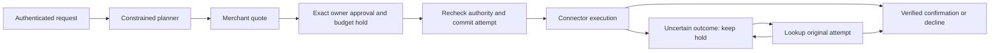

# Local-first transaction pipeline

Decision, 23 October 2026: defer cloud signup/deployment. Build and verify the transaction
foundation locally, with optional Apache tooling around it. Difficulty is prioritized by
customer/financial impact and measurable failure evidence, not infrastructure count.

## Product workflow and authority

The current Rust worker already runs this lifecycle for explicitly enrolled development
tasks. An AI proposes an offer/quantity or clarification; code enforces ownership, grants,
quote binding, budget accounting and submission. An orchestration message never constitutes
owner approval, and an uncertain result never creates authority to make a replacement write.

The gateway's development ledger remains separate from the older AgentAuth mandate service.
Unifying the authoritative permission decision is part of G3; putting a broker around the
current service does not complete that integration or supply production owner identity.

## Apache tools and their role

| Tool | Role for Cosigna | Current decision |
| --- | --- | --- |
| Apache Airflow | Repeatable batch verification, future held-out model evaluations and offline reconciliation analysis | Optional local fixture DAG implemented in `testbeds/pipeline-lab`; no customer payments or model keys |
| Apache Kafka | Future event distribution to independent consumers such as notifications and analytics | Deferred until a measured consumer/throughput need; first define transactional outbox, stable event IDs, replay/dedup and isolation |
| Apache Camel | Future routing/adapters where a concrete merchant integration benefits from its components | Candidate only; each connector still needs its own authentication, idempotency, lookup and compensation contract |

Airflow describes itself as a batch workflow platform. Kafka documents that exactly-once
results in external destination systems require cooperation with those systems. Kafka
transactions by themselves do not prevent a duplicate processor charge. Camel's idempotent
consumer filters duplicate message keys; that alone does not resolve a timed-out external
payment. These are integration tools around the transaction boundary, not another authority.

Sources checked 23 October 2026: [Airflow scope](https://airflow.apache.org/docs/apache-airflow/stable/index.html),
[Airflow local testing](https://airflow.apache.org/docs/apache-airflow/stable/core-concepts/debug.html),
[Kafka delivery semantics](https://kafka.apache.org/41/design/design/),
[Camel idempotent consumer](https://camel.apache.org/components/4.18.x/eips/idempotentConsumer-eip.html).

## High-value problems, in order

1. **Authorization a compromised agent cannot expand (G3).** Define the one authoritative
   owner/mandate decision across AgentAuth and this gateway. Bind short-lived signed permits
   to the exact transaction, agent, audience, expiry and durable attempt, with atomic single
   use, key lifecycle and owner identity. Current bearer keys and unsigned quote digests are
   not that proof. Preserve explicit offline/failure semantics; no second production rule store.
2. **Crashes and ambiguous financial outcomes (G4/G6).** The new four actual process-kill
   regressions cover fixed fixture boundaries. Extend to real connector response loss,
   expired idempotency windows, delayed/duplicate webhooks, partitions and manual recovery.
   A missing lookup must retain the hold rather than invent payment failure or retry purchase.
3. **Concurrent agents sharing a budget (G6).** Existing atomic race tests cover fixed cases.
   Add generated action sequences and conservation properties across reserve/spend/release,
   expiry/revocation, cancellation and restarts. Publish reproducible results with limitations.
4. **Order/payment disagreement (G5).** Test price/stock changes and the case where payment
   succeeds but merchant order creation fails. Keep payment, order and fulfillment separate;
   compensation is its own authorized/idempotent operation, never an assumed rollback.
5. **Reliable event delivery and operations (G4).** Add transactional outbox and deduplicated
   consumers before optional Kafka distribution. Test consumer crash/replay and broker outages
   without losing ledger truth. Add alert ownership, graceful draining and operator recovery.
6. **Intent fidelity and adoption (G5–G7).** Evaluate hosted planning on held-out ambiguous
   requests and malicious merchant content; measure clarification, unsafe proposals, latency
   and cost. Training follows a measured quality gap. Validate one narrow partner workflow
   before broad marketplace/assistant integrations or high-volume scaling claims.

## Delivered in this increment

Four process-kill regressions and an optional Airflow verification DAG, with fixed commands,
bounded fixture logs, missing/failure checks, isolated runtime and machine-readable reports.
The Rust engine still works without Airflow/Docker/cloud accounts. No runtime schema, permit,
policy, payment connector or production identity is introduced by this verification increment.
See the [lab run instructions](../testbeds/pipeline-lab/README.md) and [live roadmap](ROADMAP.md).

Deployment resumes after the relevant local gates and an actual account/target are available.
Existing Oracle instructions remain a reference; neither Oracle nor AWS is provisioned.
