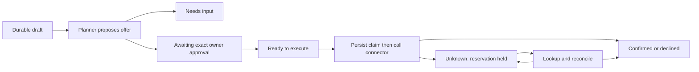

# Transaction agent pipeline

The first gateway pipeline is implemented as a caller-driven coordinator over the existing
transaction ledger. It works without a phone or a specific model provider. Its persisted
task, quote, approval, reservation and attempt are the source of truth; restarting the service
does not create another purchase or forget an uncertain result.

Each `advance` performs at most one planning, execution or reconciliation operation. It does
not run an unrestricted agent loop. An optional separate `worker` process now schedules
explicitly owner-enrolled tasks; see [persistent operation](GATEWAY_OPERATIONS.md).
A registered agent supplies
only its scoped bearer credential; the server selects the configured planner and connector.



The owner uses the existing exact-digest approval endpoint. Pipeline creation, retries, model
text and `advance` never create owner approval. Clarification pauses rather than repeatedly
invoking the model. Providing new input/refreshing an expired quote remains an explicit task
operation; this increment does not add a conversation or quote-refresh API.

## API

The existing loopback development server exposes these authenticated routes:

| Route | Input | Result |
| --- | --- | --- |
| `POST /gateway/v1/pipelines` | Existing strict `TaskInput` | Idempotently create/recover the task, then perform one allowed step |
| `GET /gateway/v1/pipelines/{task_id}` | No body | Current persisted task and derived pipeline status; no model/payment mutation |
| `POST /gateway/v1/pipelines/{task_id}/advance` | `{}` only | Plan a draft, execute an approved task, or reconcile an attempt; otherwise return its waiting/terminal state |
| `POST /gateway/v1/tasks/{task_id}/approve` | `{quote_digest}` | Existing owner-only exact approval; separate from the pipeline |

Pipeline ID equals task ID. There is no second independently authoritative workflow record.
Registered credentials retain task isolation, budget binding, plan/execute permissions, expiry
and revocation. Owner-authorized execution is supported as before. A plan-only agent cannot
gain execution permission by using this API. Status responses do not themselves confer authority.

Responses use `cosigna.pipeline/v1`, including errors on pipeline routes. Success fields are
`schema`, `simulated_provider`, `pipeline_id`, `agent_id`, `status`, `next_action`,
`blocked_reason`, `approval_digest`, and `data` (the unchanged existing task). The complete
quote remains visible in `data`; the owner must review its exact details before approval.

| Status | Meaning / next action |
| --- | --- |
| `ready_to_plan` | An authorized caller may advance the draft |
| `needs_input` | Obtain user input; no inference loop or approval |
| `awaiting_approval` | Owner reviews and approves the exact quote |
| `ready_to_execute` | An authorized executor may advance; recheck authority before claiming |
| `reconciling` | Lookup an existing attempt; never submit a replacement |
| `needs_review` | Budget inactive, agent inactive or quote expired; review/cancel before submission |
| `confirmed`, `declined`, `cancelled` | Terminal result; advance has no new external effect |

Submission/unknown states still reconcile after quote, budget or agent expiry/revocation via
the authenticated owner. Expiry is not proof that an existing payment failed. Pre-submission
review states leave reservations held until explicit cancellation or valid state transition.
If a response is lost, recover the same task/pipeline; do not create a replacement key/order.
Concurrent advances share the core's single durable submission claim.

## Local demonstration

```powershell
cd C:\Users\Harsha\Pictures\project
cargo run -p cosigna-agent -- pipeline-demo
```

An isolated fixture owner test driver approves one exact quote. The report shows
`awaiting_approval` → `ready_to_execute` → `confirmed`, recovery after service reopen,
a safe terminal replay, one synthetic order, 700 minor units spent and 300 remaining.
No live money, physical order, model API call or credential output is involved.

For hosted planning, the existing server can explicitly select its supported Groq/OpenAI
adapter. Real inference requires a backend key and consumes provider quota; CI uses fixtures
and fake transports. The model still receives no approval or execution tool. Model training
and independent quality/attack evaluations are separate work.

## Persistent operation and remaining work

The bounded local worker/queue is implemented: explicit enrollment, durable operation markers,
single-process scheduling, bounded concurrent inference, approval polling, lookup backoff and
review after interrupted inference. It uses the existing approval/claim/reconciliation
boundaries and never auto-enrolls old tasks. Systemd templates support a private sandbox pilot;
target-host operation is not yet verified. Distributed workers, public API rate limits,
production owner identity, signed one-time transaction permits, authoritative AgentAuth
integration and a supported live connector remain separate gates. Do not expose the current
loopback lab as a production service.

Tests cover approval gating, model-call repetition, scope escalation, service reopen,
uncertain provider outcomes, concurrent execution, expiry/revocation and HTTP versioning.
These controlled tests do not establish universal exactly-once execution, protection against
a compromised local OS account, or production readiness. See [the roadmap](ROADMAP.md).
