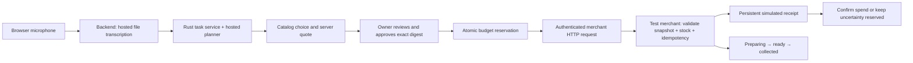

# Cosigna voice commerce lab

**Phone integration:** use `npm run dev:mobile:stripe` (fixture planner + Stripe test),
`npm run dev:mobile` (fully simulated), `npm run dev:mobile:groq` (Groq voice/planning + Stripe
test), or `npm run dev:mobile:ai` (OpenAI planner + Stripe
test). These isolated profiles use 3097/3098. The paired Expo app and exact USB instructions
are in [the Android phone test guide](../../docs/PHONE_VOICE_TEST.md). Existing browser modes
keep their ports/profiles and session/CSRF protection. Google Assistant/Swiggy/Zomato are
not integrated by this milestone.

## Groq phone test

Stop the previous phone-lab process first. In PowerShell:

```powershell
cd C:\Users\Harsha\Pictures\project\testbeds\voice-merchant
$env:COSIGNA_GROQ_API_KEY = [System.Net.NetworkCredential]::new('', (Read-Host 'Groq API key' -AsSecureString)).Password
npm run dev:mobile:groq
```

Groq hosts `whisper-large-v3-turbo` for transcription and `openai/gpt-oss-120b` for planning.
This uses Groq quota and its own API key, not OpenAI API credits. Create a key at
https://console.groq.com/keys. No key goes in the mobile bundle. Restart the server, reload
the phone, refresh the browser, and re-pair with a fresh six-digit code after this update.
The consent switches name Groq and use provider-specific authorization headers. There is no
automatic fallback to another provider.

`npm run dev:groq` runs browser Groq mode with simulated payments; `npm run dev:stripe:groq`
adds Stripe sandbox. `npm run check:groq` performs an explicitly selected real-provider
test in an isolated temporary profile: Windows synthetic speech → Groq transcription →
Rust/Groq plan → test-driver approval of exactly one $7 oat latte → Stripe sandbox.
It verifies unapproved/wrong-digest refusal, replay, and over-budget blocking and writes
`reports/groq-protocol-*.json`. On other platforms, supply a recording with
`npm run check:groq -- --audio /path/to/order.wav`. No live money moves. This consumes Groq
quota and is separate from the automated fake-transport test suite and physical phone checks.
On a failed check, inspect its preserved profile before starting another payment check.

Sources: [Groq speech](https://console.groq.com/docs/speech-to-text),
[Responses API](https://console.groq.com/docs/responses-api),
[structured output](https://console.groq.com/docs/structured-outputs),
[free-plan limits](https://console.groq.com/docs/rate-limits).

A small test café with its **own HTTP merchant API**, persistent stock, orders and a staff
fulfillment screen. Cosigna connects over HTTP; it does not edit the merchant database.
The browser can record a voice request, ask the hosted planner for a catalog choice, display
an exact quote, and submit the purchase after one explicit approval click.

**No real money moves.** The default mode simulates payment locally. The new **Stripe sandbox
mode calls the actual Stripe API** and creates verifiable test PaymentIntents and Charges.
The café, inventory and physical pickup remain test data. Neither mode proves a live merchant
purchase. See the [merchant research and pilot
plan](../../docs/MERCHANT_API_PILOT.md) for the external-merchant path.

## Stripe payment-layer test (no OpenAI key needed)

```powershell
cd C:\Users\Harsha\Pictures\project\testbeds\voice-merchant
npm install
npm run dev:stripe
```

Open **http://127.0.0.1:3095**. Set a test allowance, use an exact fixture example, review the
Stripe sandbox quote, and approve it. A successful order shows its **PaymentIntent ID** and
a **View Stripe test payment** link. Use the same sandbox/test account in Stripe's Dashboard.
This mode runs Cosigna on 3096 and uses a separate `stripe-v1` data profile; the old 3093/3094
simulator and its orders stay separate. Starting the app does not charge anything.

The backend uses `COSIGNA_STRIPE_TEST_SECRET_KEY` when set. Otherwise it reads only the existing
Northwind credential named `stripe-test` from the Fabric local secret store. The key is never
printed, put in a prompt, copied into the merchant database or sent to the browser. Both
`sk_test_` and `rk_test_` secret keys are accepted; live and publishable keys are refused.
The restricted key needs Balance read and PaymentIntents read/write. To configure a different
test key locally:

```powershell
$env:COSIGNA_STRIPE_TEST_SECRET_KEY = [System.Net.NetworkCredential]::new('', (Read-Host 'Stripe TEST secret key' -AsSecureString)).Password
npm run dev:stripe
```

The fixed payment source is Stripe's `pm_card_visa`, used only in test mode. No card numbers
or customer payment credentials are collected. The quote states that the card/payment and
pickup are tests. This validates the processor boundary, not real card collection, SCA or a
delegated card mandate. `npm run dev:stripe:ai` adds the hosted planner when an OpenAI key is
configured; voice remains a separate configured transcription capability.

Run the explicit processor integration check with:

```powershell
npm run check:stripe
```

This **creates one $7 Stripe sandbox payment**, using a temporary local profile and a test-driver
owner approval. It verifies execution without approval is blocked, wrong digests are rejected,
the confirmed amount/currency/metadata match the quote, approval replay creates no second
PaymentIntent, and an over-budget purchase is blocked before Stripe. A sanitized evidence
JSON file is written under `reports/`. Real Stripe objects remain in your sandbox for review.
No real funds move. If a check stops unresolved, its diagnostic profile is preserved and the
script does not automatically rerun a new payment.

## Stripe execution and recovery

Before any Stripe mutation, one SQLite transaction records the stable attempt, full approved
quote and stock reservation. Cosigna has already reserved the user's budget and persisted its
own submission intent. The merchant creates an **unconfirmed** PaymentIntent with idempotency
and quote/task/order/merchant metadata, verifies the returned fields and persists its ID. Only
then does it durably claim confirmation and call Stripe. A retrieved `succeeded` intent with
the exact received amount creates a paid order and lets Cosigna convert its budget reservation
to spent. Creation/confirmation each have different stable idempotency keys.

The adapter uses Stripe's current `allowed_payment_method_types` parameter, limited to cards.
The first real API check caught rejection of the old `payment_method_types` parameter before
any PaymentIntent existed; a fresh successful check verified the corrected wire contract.
[Create PaymentIntent](https://docs.stripe.com/api/payment_intents/create),
[confirm PaymentIntent](https://docs.stripe.com/api/payment_intents/confirm).

Declines/authentication-required test results are canceled, and stock/budget is released only
after Stripe returns a matching terminal `canceled` intent with zero received. `processing`,
missing responses and mismatched amounts/metadata/livemode remain unresolved and reserved.
Reconciliation retrieves a saved ID, or uses bounded list lookup by metadata if creation's
response was lost. It never automatically creates or confirms a replacement payment. A lost
unconfirmed creation can therefore remain held for operator investigation. No read-after-write
Search API assumption is used. The loopback connector retains its v1 `simulated:true` receipt:
Stripe test funds are still simulated; processor proof appears separately on the merchant order.

Stripe stock reservations are held before payment, consumed on verified success, and released
once on verified cancellation. A duplicate/stale result cannot decrement stock twice or regress
a terminal payment state. Replays retain the originally selected test card/scenario. Production
card capture/refunds, distributed job recovery and signed delegated payment grants remain work.

Optional signed webhooks: set `COSIGNA_STRIPE_WEBHOOK_SECRET` to the local Stripe listener's
`whsec_...` value before starting the app. With Stripe CLI installed, forward only test events:

```powershell
stripe listen --forward-to http://127.0.0.1:3095/stripe/webhook
```

The endpoint verifies raw-body HMAC signatures, a five-minute timestamp tolerance, test-only
events and event-ID deduplication; then it retrieves and validates the PaymentIntent against
the saved quote. It never trusts the webhook payload alone as payment proof. It updates the
merchant record; **Check status** reconciles the corresponding Cosigna reservation. Webhooks
are optional for the synchronous local test and must not be exposed publicly without a proper
deployment boundary. External webhook delivery has not been verified in this environment.

Stripe mode's private store binds to a SHA-256 fingerprint of its test credential, so changing
accounts/keys cannot silently reconcile pending payments against another account. Key rotation
needs an explicit new profile/recovery plan in this development version.

## Start on Windows

Requires Node.js 24 (tested with 24.21.0), the repository's Rust toolchain and an OpenAI API
key with access to the configured models. From PowerShell:

```powershell
cd C:\Users\Harsha\Pictures\project\testbeds\voice-merchant
npm install

# Skip this prompt if the key is already set in this terminal. Never paste it into chat.
$env:COSIGNA_OPENAI_API_KEY = [System.Net.NetworkCredential]::new('', (Read-Host 'OpenAI API key' -AsSecureString)).Password

npm run dev
```

Open **http://127.0.0.1:3093** on this computer. The launcher builds the Rust binary, starts
the merchant/browser server on 3093, initializes a separate agent ledger and starts Cosigna
on 3094. It does not replace the earlier 3092 development service. Ctrl+C stops both services.
The launcher builds in `target/voice-merchant-build` and runs a profile-local executable copy,
so an existing Windows server cannot lock Cargo's build artifact.
There is no production npm dependency; jsdom is used only for client DOM tests.

To test typed ordering without a key:

```powershell
npm run dev:fixtures
```

Fixture mode recognizes exactly `Order one oat latte` and `Order one black coffee`. It is
**not AI**. Voice is available in either mode only if the server has an API key; transcription
requests are real paid API calls when using that key. Hosted planning runs only in the default
`npm run dev` mode. No inference occurs merely by opening the page. Inference costs are separate
from the simulated purchase budget.

The offline page provides buttons to fill either supported example. Additional wording such
as `for pickup on my way to office` is outside this script's supported requests. It produces
no quote, order or spend. The page explains this and offers examples; **Check status** appears
only after submission, when there is a merchant result to check. Accepted order status also
shows whether staff marked that test order preparing, ready or collected.

## Exercise the voice purchase

1. Set a $20 test allowance and a $10 per-order cap. This is an expiring allowance, not a funded wallet.
2. Click **Speak your order**, allow microphone access and say “Order one oat latte for pickup.”
3. Click **Stop recording**, or let the 20-second limit stop it. The app transcribes and plans the request.
4. Review item, quantity, all-in total, seller, pickup terms and quote expiry. In hosted mode,
   missing details produce a clarification; edit the request to continue.
5. Click **Approve & place test order**. The owner role approves the exact quote digest; the
   executor role submits it. The planner has neither role token.
6. See the accepted order in the merchant counter and the stock decrease by one. Staff can mark
   it **ready for pickup**, then **collected**. Payment acceptance alone does not mean it is ready.

The browser reads confirmations aloud through available OS/browser speech synthesis. This
is push-to-talk with recorded-file transcription, not a continuous or interruptible voice
agent. It has no Siri/Google Assistant integration, speaker recognition or identity verification.
The approval click is the local development owner's action; speech alone cannot authorize
payment. The model cannot invoke the approval route.

Browser support and microphone permission vary. The page has a typed fallback. Test the actual
microphone on the intended browser before claiming voice works on that device. This localhost
app runs on the development computer. The new native app connection uses explicit one-use
pairing and ADB reverse forwarding for Android USB development only. Without forwarding,
opening a phone to `127.0.0.1` reaches that phone, not the PC. Remote/mobile-network access
still needs authenticated HTTPS; do not expose these development ports publicly.

## Architecture and data



Windows data: `%LOCALAPPDATA%\Cosigna\voice-merchant-lab\v1`. macOS uses
`~/Library/Application Support/Cosigna/voice-merchant-lab/v1`; other platforms use
`~/.local/share/Cosigna/voice-merchant-lab/v1`. Defaults are outside the source tree.

- `merchant.sqlite`: independently versioned merchant inventory, attempts, orders, local
  task references and development settings. Includes a private merchant API token.
- `agent/transactions.sqlite`: existing agent ledger schema v1, separate from the merchant.
- `agent/test-merchant-connection.json`: versioned non-secret URL/instance binding. A ledger
  cannot silently switch to fixtures or a replaced merchant database at the same address.
- `agent/credentials.json`: owner/planner/executor tokens. Only the Node backend loads these;
  they never enter frontend JavaScript, model context or audio requests.

Audio is held in memory for the transcription request, not saved to disk by the lab.
Transcripts become task requests and are persisted in the agent ledger. Audio is sent to
the selected OpenAI or Groq provider when transcription is used. The purchase request and merchant catalog are sent to the
hosted planner. Provider retention is governed by the provider/account configuration; the
lab makes no zero-retention claim. Requests and credentials are not logged.

The UI is a trusted, single-user development console available to local processes. It uses
an HttpOnly SameSite cookie, CSRF token, exact Origin/Host checks, no CORS, a content security
policy, body limits and a separate merchant bearer token/instance header. Those checks do
not provide production user identity, local-account isolation, rate limiting or public TLS.
Unix data directories/files restrict owner access; Windows inherits profile-directory ACLs.
The lab must stay on loopback. Existing distributed production guarantees are not implied.

The test merchant checks the full offered product snapshot, quantity, total, expiry and
stock. An immediate SQLite transaction records an idempotency fingerprint/result, order and
stock decrement together. The merchant accepts Cosigna's quote digest as a correlation value;
it does not independently verify user identity or a cryptographic spending grant. Its own
idempotency fingerprint uses canonical JSON plus SHA-256. Cosigna verifies receipt fields
against the approved quote before settling the ledger. An uncertain result keeps the budget
held until lookup yields a matching receipt. It never blindly submits again.

## Merchant API contract

Every response uses `schema: cosigna.test-merchant/v1`. The merchant API requires a backend
bearer token. All endpoints except `info` also require `X-Cosigna-Merchant-Instance` matching
the pinned instance ID. Browser origins are rejected on these endpoints.

| Endpoint | Purpose |
|---|---|
| `GET /merchant/v1/info` | Instance ID and `mode: test` |
| `GET /merchant/v1/catalog` | In-stock typed offers with all-in unit prices |
| `POST /merchant/v1/orders` | `{attempt_key, quote_digest, quote, scenario}`; validate and submit |
| `GET /merchant/v1/attempts/{key}` | Observed receipt, rejected result or absent result |

The endpoint is fixed by operator configuration, not by model output. Rust permits only a
numeric `http://127.0.0.1:<port>` test merchant, disallows redirects, and checks instance identity
on every operation. It is deliberately not a generic Internet merchant client or live connector.
Success responses contain `data`; merchant errors use a versioned `{error:{code,message}}`
envelope. A receipt says `simulated:true` and cannot be presented as a processor payment.

The browser talks only to a local `/api/*` backend-for-frontend. It cannot choose agent role
tokens, merchant URLs, payment sources, test failure scenarios or a different user's task.
Its `/api/transcribe` route accepts up to 8 MiB of recorded audio; JSON routes accept 16 KiB.
Static assets and API results do not cache secrets. The `/api/state` response's CSRF token is
for this local browser session; the merchant and agent credentials remain server-side.

## Tests

```powershell
npm test
cd ..\..
cargo fmt --all --check
cargo clippy --workspace --all-targets -- -D warnings
cargo test --workspace
```

Tests use temporary stores, a real Rust subprocess, real loopback merchant HTTP and fake
transcription/model boundaries. They cover voice-control DOM behavior, microphone denial,
no submission before an approval click, safe text rendering, authentication/CSRF/Host checks,
actual API order and stock updates, concurrent approval replays, over-budget blocking,
fulfillment transitions, dropped HTTP responses, mismatched receipts and merchant identity
replacement. Multipart transcription request shape and rejection paths are tested separately.
The default suite makes no paid API call. Browser rendering, a real microphone and hosted
inference quality have not been verified automatically. Processor verification uses the
separate explicit Stripe check below.

`npm test` also checks Stripe request shape, fake-processor success/decline/uncertainty,
reservation retention, receipt mismatches, replay, webhook signature/deduplication and the
complete Rust-to-merchant-to-processor path using an injected Stripe transport. It makes no
external payment calls. `npm run check:stripe` is the separate opt-in real Stripe sandbox
check described above, and has passed with a $7.00 test PaymentIntent. This does not establish
live-funds readiness or a voice model's interpretation accuracy.
